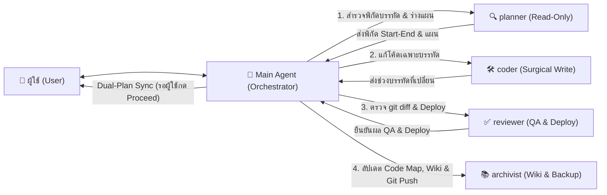

# 🤖 AI WORKFLOW & MULTI-SUBAGENT BLUEPRINT
## พิมพ์เขียวระบบการทำงาน กฎเหล็ก และสถาปัตยกรรม AI สำหรับนำไปใช้กับโปรเจกต์ใหม่ (Portable AI Operating System)

> [!IMPORTANT]
> **วัตถุประสงค์ของเอกสารนี้:**
> เอกสารนี้รวบรวม **กฎเหล็ก สถาปัตยกรรม Multi-Subagent (4 บทบาทเฉพาะทาง) ระบบประหยัด Token ("อ่านครั้งเดียว แก้เฉพาะจุด ทดสอบเฉพาะส่วน") ระบบวางแผนคู่ขนาน (Dual-Plan Sync) ตารางเลือกโมเดล AI และโครงสร้างฐานความรู้ (Second Brain Wiki)** ทั้งหมดของโปรเจกต์นี้ให้อยู่ในรูปแบบ **Portable Blueprint**
> 
> **วิธีนำไปใช้กับโปรเจกต์ใหม่:**
> เพียงคัดลอกไฟล์นี้ (หรือแนบไฟล์นี้ให้ AI ในโปรเจกต์ใหม่) แล้วสั่งว่า:
> *"จงอ่านไฟล์ `AI_Workflow_Blueprint.md` แล้วสร้างโครงสร้างระบบการทำงาน `.agents/`, `Wiki/`, และ `Working/` ตามพิมพ์เขียวนี้ให้กับโปรเจกต์ใหม่ทั้งหมด"*

---

## 🏗️ 1. โครงสร้างโฟลเดอร์มาตรฐานของโปรเจกต์ (Clean Workspace Architecture)

ทุกโปรเจกต์ที่ใช้ระบบนี้ต้องจัดระเบียบโฟลเดอร์เป็น **4 โซนหลัก** โดยห้ามมีไฟล์ขยะหรือไฟล์ทดสอบวางเกะกะที่ Root Directory เด็ดขาด:

```text
<Project-Root>/
├── .agents/                          # 🧠 ศูนย์ควบคุมกฎและโปรไฟล์ของ AI ทั้งระบบ
│   ├── AGENTS.md                     # กฎหลักของ Main Agent (Orchestrator) ที่โหลดอัตโนมัติทุกแชท
│   ├── agents/                       # โปรไฟล์ของ Subagents เฉพาะทางทั้ง 4 ตัว
│   │   ├── planner.md                # 1. นักสำรวจพิกัดโค้ดและเขียนแผน (Read-Only)
│   │   ├── coder.md                  # 2. นักเขียนโค้ดและแก้บั๊กเฉพาะจุด (Surgical Write)
│   │   ├── reviewer.md               # 3. ผู้ตรวจ git diff, QA และ Deploy (QA & Push)
│   │   └── archivist.md              # 4. ผู้ดูแล Wiki, Code Map, Skills และ Git Backup
│   └── skills/                       # คลังทักษะและบทเรียนเทคนิคเฉพาะทาง (<skill-name>/SKILL.md)
│
├── Wiki/                             # 📚 สมองที่สองของโปรเจกต์ (Second Brain - ดูแลโดย archivist)
│   ├── index.md                      # สารบัญหลักของฐานความรู้ทั้งหมด
│   ├── log.md                        # บันทึกประวัติการอัปเดตองค์ความรู้ตามลำดับเวลา
│   ├── Code_Map.md                   # แผนผังโครงสร้างโปรเจกต์ & พิกัดเลขบรรทัด (StartLine-EndLine) ของทุกฟังก์ชัน
│   ├── Database_Schema.md            # โครงสร้างตารางฐานข้อมูลและคอลัมน์จริง (Source of Truth)
│   ├── Entities/                     # ข้อมูลจำเพาะของแต่ละแอป/ระบบย่อย
│   └── Concepts/                     # แนวคิด กฎธุรกิจ และข้อจำกัดทางเทคนิคเชิงลึก
│
├── Working/                          # 📋 พื้นที่ติดตามสถานะงานปัจจุบัน
│   ├── CURRENT_STATE.md              # สรุปสถานะล่าสุด (ห้ามเกิน 40 บรรทัด — อ่านไฟล์แรกเมื่อเปิดแชทใหม่!)
│   ├── task.md                       # เช็คลิสต์งานปัจจุบันและสถานะความคืบหน้า
│   ├── implementation_plan.md        # แผนการดำเนินงานฉบับถาวร (ซิงค์ตรงกับ Interactive Artifact Plan 100%)
│   ├── Master_plan.md                # แผนแม่บทภาพรวมของทั้งโปรเจกต์
│   ├── system_urls.md                # รวม URL, Script ID, Database ID และบัญชีทดสอบของโปรเจกต์
│   └── Archive/                      # เก็บประวัติ SESSION_LOG เก่า, แผนงานที่จบแล้ว และสคริปต์ตรวจสอบเก่า
│
└── <app-folder-1>/, <app-folder-2>/  # 💻 โฟลเดอร์ Source Code ของแต่ละแอปพลิเคชัน
```

---

## 🤖 2. สถาปัตยกรรม Multi-Subagent (Orchestrator + 4 Specialized Subagents)

**Main Agent (Orchestrator)** ทำหน้าที่สื่อสารกับผู้ใช้ ควบคุมทิศทาง สร้างแผนแบบตอบโต้ (Interactive Plan) และกระจายงานให้ **Subagents เฉพาะทาง 4 ตัว** ตามลำดับขั้นตอนดังนี้:



### การลงทะเบียน Subagents (`define_subagent`)
เมื่อเริ่มแชทใหม่และยังไม่มี Subagents ในเซสชัน ให้ Main Agent เรียก `define_subagent` ตามสิทธิ์เครื่องมือดังนี้:
- **`planner`:** `enable_write_tools: false` (อ่านอย่างเดียว ปลอดภัย 100%)
- **`coder`:** `enable_write_tools: true` (แก้ไขไฟล์โค้ดตามแผนที่อนุมัติแล้ว)
- **`reviewer`:** `enable_write_tools: true` (รัน `git diff` และคำสั่ง Deploy เช่น `clasp push` หรือ Build/Test)
- **`archivist`:** `enable_write_tools: true` (อัปเดต `Wiki/`, `Working/CURRENT_STATE.md`, และรัน `git push`)

---

## 🎯 3. ตารางเลือกโมเดล AI และระดับการคิด (Model & Effort Selection Matrix)

> [!CAUTION]
> **กฎเหล็กสูงสุด:** ❌ **ห้ามใช้ Gemini Flash 3.8 (`Low`) หรือ `"flash_lite"` ในทุกกรณี!** เพื่อป้องกันการตกหล่นรายละเอียดหรือทำโค้ดพัง

### 3.1 การตั้งค่าโมเดลสำหรับ Main Agent (บนหน้าจอ UI ของผู้ใช้)
| สัดส่วนงาน | ประเภทงานของ Main Agent | โมเดลและระดับที่แนะนำ |
| :---: | :--- | :--- |
| **90%** | **งานประจำวันทั่วไป** (สั่งงาน Subagents, คุยแผน, สรุปผล, แก้ไขงานทั่วไป) | **Gemini 4 Argon (`Low`)** *(ค่าเริ่มต้น)* |
| **8%** | **งานออกแบบโครงสร้างใหม่ข้ามระบบ** (วางสถาปัตยกรรมใหม่, แกะระบบขนาดใหญ่) | **Gemini 4 Argon (`Medium`)** |
| **2%** | **งานแก้บั๊กวิกฤตเรื้อรังที่ซับซ้อนมาก** (เมื่อแก้เสร็จให้สลับกลับเป็น `Low` ทันที) | **Gemini 4 Argon (`High`)** |

### 3.2 การเลือกโมเดลสำหรับ Subagents ทั้ง 4 ตัว (`invoke_subagent`)
| Subagent | กรณีใช้งาน (Use Case) | ค่า `Model` ใน `invoke_subagent` | โมเดลและระดับการคิดเทียบเท่า |
| :--- | :--- | :---: | :--- |
| **1. `planner`** | **กรณี A:** สำรวจพิกัดโค้ดจาก `Code_Map.md` / เทียบตารางทั่วไป | `"flash"` | **Gemini Flash 3.8 (`Medium` / `High`)** |
| | **กรณี B:** วางแผนอัลกอริทึมซับซ้อน / กระทบหลายไฟล์ข้ามระบบ | `"pro"` หรือ `"inherit"` | **Gemini 4 Argon (`Low` / `Medium`)** |
| **2. `coder`** | **กรณี A:** แก้ไขโค้ดเล็กน้อย, ข้อความป้ายชื่อ UI, CSS, หรือค่าคงที่เฉพาะจุด | `"flash"` หรือ `"inherit"` | **Gemini Flash 3.8 (`High`)** หรือ **Gemini 4 Argon (`Low`)** *(ห้ามใช้ Flash Low/Medium)* |
| | **กรณี B:** เขียนฟังก์ชัน Backend/Frontend, ผูก Logic ข้อมูล, หรือแก้บั๊ก | `"pro"` หรือ `"inherit"` | **Gemini 4 Argon (`Low` / `Medium`)** |
| **3. `reviewer`** | **กรณี A:** ตรวจ `git diff` ตามเช็คลิสต์มาตรฐาน และรันคำสั่ง Deploy (95% ของงาน) | `"flash"` | **Gemini Flash 3.8 (`Medium`)** |
| | **กรณี B:** ตรวจความปลอดภัยเชิงลึกเมื่อแก้ระบบ Auth / SSO / Permission | `"pro"` | **Gemini 4 Argon (`Low` / `Medium`)** |
| **4. `archivist`** | **ทุกกรณี:** อัปเดต `Code_Map.md`, `Wiki/`, `CURRENT_STATE.md` และ `git push` | `"flash"` | **Gemini Flash 3.8 (`Medium`)** |

---

## 📋 4. กฎเหล็กการวางแผนคู่ขนาน (Dual-Plan Sync Rule & Approval Gate)

ทุกครั้งที่มีการสร้างหรือปรับปรุงแผนการดำเนินงาน Main Agent **ต้องเขียนและซิงค์แผนงานลง 2 จุดควบคู่กันเสมอ**:

1. **Interactive Artifact Plan (`<ArtifactDir>/<topic>_plan.md` เช่น `auth_refactor_plan.md`):**
   - ต้องตั้งชื่อไฟล์ให้สื่อความหมายเฉพาะเรื่อง (**ห้ามตั้งชื่อว่า `implementation_plan.md` ซ้ำกับไฟล์ใน `Working/`** เพื่อป้องกันแท็บใน IDE ชนกัน)
   - ต้องกำหนด `ArtifactMetadata: { RequestFeedback: true, UserFacing: true }` เสมอ เพื่อให้ผู้ใช้อ่าน คอมเมนต์รายบรรทัด และกดปุ่มอนุมัติบน UI ได้
2. **Workspace Implementation Plan (`Working/implementation_plan.md`):**
   - บันทึกเนื้อหาเดียวกัน 100% ลงในโฟลเดอร์โปรเจกต์ เพื่อให้ระบบและ Subagents จดจำแผนงานได้อย่างถาวรข้ามเซสชัน

### เงื่อนไขการอนุมัติแผน (Approval Gate)
- **ผู้ใช้กดปุ่ม `Review` (หรือส่ง Comment บนแผน):** คือการให้ข้อเสนอแนะเพื่อปรับปรุงแผน **ห้ามลงมือแก้ไข Source Code เด็ดขาด** ให้ปรับปรุงแผนทั้ง 2 จุดแล้วส่งให้ตรวจใหม่
- **ผู้ใช้กดปุ่ม `Proceed` (หรือพิมพ์อนุมัติชัดเจน):** คือการอนุมัติให้เรียก `coder` เริ่มแก้ไข Source Code ตามแผนได้

---

## ⚡ 5. กฎการอ่านและแก้ไขโค้ดแบบประหยัด Token (Surgical Token-Diet Rules)

1. **เริ่มแชทใหม่แบบเบาที่สุด (Fast Boot):**
   - เมื่อเปิดแชทใหม่ **ห้ามอ่านไฟล์ประวัติยาวๆ (`SESSION_LOG`)** ให้เริ่มด้วยการอ่าน `Working/CURRENT_STATE.md` (ไม่เกิน 40 บรรทัด) และ `Working/task.md` เท่านั้น
2. **อ่านครั้งเดียว แก้เฉพาะจุด (Read-Once via `Wiki/Code_Map.md`):**
   - ก่อนเปิดอ่านไฟล์โค้ดใดๆ ต้องดูตารางพิกัดบรรทัดใน `Wiki/Code_Map.md` ก่อนเสมอ แล้วใช้ `view_file` โดยระบุ `StartLine` และ `EndLine` เจาะจงเฉพาะฟังก์ชันที่ต้องการแก้ (ครั้งละไม่เกิน 150 บรรทัด)
3. **ห้ามใช้คำสั่ง Terminal อ่านหรือแก้ไขไฟล์ (No-Terminal-For-Files Rule):**
   - ใช้เครื่องมือ `view_file` สำหรับอ่านไฟล์, `write_to_file` สำหรับสร้างไฟล์ใหม่, และ `replace_file_content` สำหรับแก้ไขโค้ดเฉพาะจุดเท่านั้น
   - ❌ **ห้ามใช้คำสั่ง Terminal (`powershell`, `cat`, `Get-Content`, `Select-String`, `grep`, `sed`) ในการอ่านหรือแก้ไขไฟล์เด็ดขาด!**
4. **กฎรักษาความสะอาดโฟลเดอร์ (Zero-Clutter Rule):**
   - ❌ **ห้ามสร้างไฟล์ทดสอบหรือไฟล์ชั่วคราว (`.js`, `.py`, `.tmp`, `.bak`, `scratch.txt`) ทิ้งไว้ใน Root หรือ `Working/` เด็ดขาด** หากต้องใช้สคริปต์ชั่วคราวให้สร้างใน `<ArtifactDir>/scratch/` เท่านั้น

---

## 📄 6. แม่แบบไฟล์ตั้งต้นสำหรับคัดลอกไปใช้ในโปรเจกต์ใหม่ (Ready-to-Copy Templates)

เมื่อเริ่มโปรเจกต์ใหม่ ให้ AI สร้างไฟล์ตั้งต้นตามแม่แบบด้านล่างนี้ทันที:

### 6.1 แม่แบบไฟล์ `.agents/AGENTS.md`
```markdown
# กฎและข้อกำหนดในการพัฒนาระบบ (Orchestrator, 4 Subagents & Surgical Workflow)

> [!IMPORTANT]
> ไฟล์นี้คือศูนย์กลางควบคุมการทำงานของ **Main Agent (Orchestrator)** เพื่อประหยัด Token สูงสุด (**"อ่านครั้งเดียว แก้เฉพาะจุด ทดสอบเฉพาะส่วน"**) โดยกระจายงานให้ **Subagents เฉพาะทาง 4 ตัว** และดูแลฐานความรู้ใน `Wiki/`

## 🤖 1. สถาปัตยกรรม Multi-Subagent (4 บทบาทเฉพาะทาง)
1. **`planner` (นักสำรวจและเขียนแผน - Read-Only):** อ่าน `Wiki/Code_Map.md` เพื่อหาพิกัดไฟล์และเลขบรรทัด (`StartLine`–`EndLine`) เปิดอ่านโค้ดเฉพาะช่วงบรรทัดที่เกี่ยวข้อง (ห้ามเกินครั้งละ 150 บรรทัด) แล้วส่งร่างแผนกลับมาให้ Main Agent
2. **`coder` (นักเขียนโค้ดและแก้บั๊กเฉพาะจุด - Surgical Write):** ทำงานหลังจากผู้ใช้กดอนุมัติแผน (**Proceed**) แล้วเท่านั้น อ่านและแก้ไขเฉพาะไฟล์และช่วงบรรทัดที่ระบุในแผนด้วย `replace_file_content`
3. **`reviewer` (ผู้ตรวจสอบโค้ดและ Deploy เฉพาะจุด - QA & Deploy):** ตรวจเฉพาะ `git diff` ของไฟล์ที่แก้ เช็คกฎความปลอดภัยของระบบ และรันคำสั่ง Deploy/Test เฉพาะส่วนที่มีการแก้ไข
4. **`archivist` (ผู้สกัดองค์ความรู้ Wiki, Skills & Backup):** อัปเดตเลขบรรทัดใน `Wiki/Code_Map.md` หากบรรทัดเลื่อน, สกัดความรู้ลง `Wiki/` และ `.agents/skills/`, อัปเดต `Working/CURRENT_STATE.md` (ไม่เกิน 40 บรรทัด) และรัน `git push`

## 🎯 1.1 กฎการเลือกใช้โมเดล AI (Model & Effort Selection Matrix)
- ❌ **ห้ามใช้ Gemini Flash 3.8 (`Low`) หรือ `"flash_lite"` ในทุกกรณี!**
- **Main Agent:** งานทั่วไป (90%) = **Gemini 4 Argon (`Low`)** | งานออกแบบโครงสร้างข้ามระบบ (8%) = **Argon (`Medium`)** | งานแก้บั๊กวิกฤต (2%) = **Argon (`High`)**
- **Subagents (`invoke_subagent`):**
  - `planner`: สำรวจทั่วไป = `"flash"` | วางแผนซับซ้อน = `"pro"` / `"inherit"`
  - `coder`: แก้จุดเล็กน้อย/UI/CSS = `"flash"` (Flash High) หรือ `"inherit"` (Argon Low) | แก้ Logic/Backend/Bug = `"pro"` / `"inherit"`
  - `reviewer`: ตรวจ diff & Deploy = `"flash"` | ตรวจ Auth/Security เชิงลึก = `"pro"`
  - `archivist`: ทุกกรณี = `"flash"`

## 📋 2. กฎเหล็กการวางแผนคู่ขนาน (Dual-Plan Sync Rule)
ซิงค์แผนงานลง 2 จุดเสมอ:
1. `<ArtifactDir>/<topic>_plan.md` (`RequestFeedback: true, UserFacing: true` — ห้ามตั้งชื่อซ้ำกับ `implementation_plan.md`)
2. `Working/implementation_plan.md` (เนื้อหาตรงกัน 100%)
- กด **Review** = ปรับปรุงแผน ห้ามแก้โค้ด | กด **Proceed** = สั่ง `coder` แก้โค้ดได้

## ⚡ 3. กฎประหยัด Token และความสะอาดโฟลเดอร์
1. **Fast Boot:** เริ่มแชทใหม่ให้อ่านเฉพาะ `Working/CURRENT_STATE.md` และ `Working/task.md`
2. **Read-Once via Code Map:** ดูพิกัดบรรทัดใน `Wiki/Code_Map.md` ก่อนใช้ `view_file` เสมอ
3. **No Terminal for File I/O & Zero Clutter:** ห้ามใช้คำสั่ง Terminal อ่าน/แก้ไฟล์ และห้ามสร้างไฟล์ขยะทิ้งไว้ใน Root หรือ `Working/`
```

---

### 6.2 แม่แบบโปรไฟล์ Subagents ทั้ง 4 ตัว (`.agents/agents/*.md`)

#### 1) `.agents/agents/planner.md`
```markdown
---
name: planner
description: Surgical Planner & Code Locator (Read-Only). Reads Wiki/Code_Map.md and Working/CURRENT_STATE.md to locate exact file paths and line ranges (StartLine-EndLine), reads only the targeted line slices (max 150 lines), and returns a precise surgical implementation plan.
---
# Subagent Profile: `planner`
1. ค้นหาพิกัดโค้ดจาก `Wiki/Code_Map.md` ก่อนเสมอ ห้ามเปิดอ่านไฟล์แบบสุ่ม
2. ใช้ `view_file` ระบุ `StartLine` และ `EndLine` เท่านั้น (ครั้งละไม่เกิน 150 บรรทัด) และห้ามใช้ Terminal อ่านไฟล์
3. ส่งกลับแผนงานประกอบด้วย: สาเหตุของปัญหา, พิกัดไฟล์และเลขบรรทัด (`StartLine`–`EndLine`), รายละเอียดการแก้ไข, และวิธีตรวจสอบเฉพาะจุด
```

#### 2) `.agents/agents/coder.md`
```markdown
---
name: coder
description: Surgical Coder & Bugfixer. Receives an approved plan with exact file paths and line ranges, reads only the relevant skill and target lines, and applies minimal surgical edits using replace_file_content.
---
# Subagent Profile: `coder`
1. ทำงานเมื่อได้รับแผนที่อนุมัติแล้วเท่านั้น โดยอ่านเฉพาะช่วงบรรทัดที่ระบุในแผน ($\pm 20$ บรรทัด) ด้วย `view_file`
2. แก้ไขโค้ดด้วย `replace_file_content` หรือ `write_to_file` เท่านั้น (ห้ามใช้ Terminal แก้ไฟล์)
3. ปฏิบัติตามกฎความปลอดภัยของแพลตฟอร์มอย่างเคร่งครัด (เช่น กฎ GAS Caja Sanitizer หากเป็นโปรเจกต์ Google Apps Script)
4. รายงานชื่อไฟล์ที่แก้ไข พร้อมระบุ **ช่วงบรรทัดเดิม -> ช่วงบรรทัดใหม่** เพื่อให้ `archivist` อัปเดต `Wiki/Code_Map.md`
```

#### 3) `.agents/agents/reviewer.md`
```markdown
---
name: reviewer
description: Code Reviewer, QA Verifier & Deployer. Inspects git diff of modified files, checks for syntax/platform regressions, and deploys or tests modified modules.
---
# Subagent Profile: `reviewer`
1. รัน `git diff <path/to/modified_file>` เพื่อตรวจเฉพาะบรรทัดที่เปลี่ยนแปลงโดยไม่ต้องอ่านไฟล์เต็มซ้ำ
2. ตรวจสอบความถูกต้องของ Syntax และกฎความปลอดภัยของแพลตฟอร์ม
3. เมื่อผ่านแล้ว ให้รันคำสั่ง Deploy หรือ Test เฉพาะโมดูลที่มีการแก้ไข แล้วรายงานผลกลับให้ Main Agent
```

#### 4) `.agents/agents/archivist.md`
```markdown
---
name: archivist
description: Knowledge Curator, Wiki Maintainer, Skill Manager & Git Backup Agent. Extracts reusable knowledge into Wiki/ and .agents/skills/, updates Wiki/Code_Map.md and Working/CURRENT_STATE.md, and pushes backups to GitHub.
---
# Subagent Profile: `archivist`
1. อัปเดตตารางเลขบรรทัดใน `Wiki/Code_Map.md` ทันทีหากการแก้ไขของ `coder` ทำให้บรรทัดเลื่อน
2. สกัดความรู้/บั๊กที่พบลง `Wiki/Entities/`, `Wiki/Concepts/`, หรือ `.agents/skills/` พร้อมอัปเดต `Wiki/index.md` และ `Wiki/log.md`
3. อัปเดต `Working/CURRENT_STATE.md` (ห้ามเกิน 40 บรรทัด)
4. รัน `git add .`, `git commit -m "..."`, และ `git push origin main` เพื่อสำรองข้อมูล
```

---

### 6.3 แม่แบบไฟล์ `Working/CURRENT_STATE.md` (ไม่เกิน 40 บรรทัด)
```markdown
# 📌 สถานะปัจจุบันของโปรเจกต์ (Current State - Fast Boot)

## 1. ภาพรวมและเฟสปัจจุบัน
- **ชื่อโปรเจกต์:** <ระบุชื่อโปรเจกต์>
- **สถานะปัจจุบัน:** <ระบุเฟสหรือเป้าหมายที่กำลังทำ>

## 2. งานที่เพิ่งทำเสร็จล่าสุด (Recent Completed)
- <รายการที่ 1>
- <รายการที่ 2>

## 3. งานถัดไปที่ต้องทำต่อ (Next Action Items)
1. <งานถัดไปลำดับที่ 1>
2. <งานถัดไปลำดับที่ 2>

## 4. พิกัดเอกสารสำคัญ
- แผนผังโค้ดและเลขบรรทัด: `Wiki/Code_Map.md`
- โครงสร้างฐานข้อมูล: `Wiki/Database_Schema.md`
- แผนงานปัจจุบัน: `Working/implementation_plan.md` และ `Working/task.md`
```

---

## 🚀 7. คำสั่งเริ่มต้นสำหรับสั่ง AI เมื่อเปิดโปรเจกต์ใหม่ (One-Shot Bootstrap Prompt)

เมื่อคุณสร้างโฟลเดอร์โปรเจกต์ใหม่ ให้วางไฟล์ `AI_Workflow_Blueprint.md` นี้ลงในโปรเจกต์ แล้วคัดลอกข้อความด้านล่างนี้สั่ง AI ได้ทันที:

```text
โปรดอ่านไฟล์ AI_Workflow_Blueprint.md แล้วติดตั้งระบบการทำงาน AI ให้โปรเจกต์นี้ตามขั้นตอนต่อไปนี้:
1. สร้างไฟล์ .agents/AGENTS.md และโปรไฟล์ Subagents ทั้ง 4 ตัวใน .agents/agents/ (planner.md, coder.md, reviewer.md, archivist.md)
2. ลงทะเบียน Subagents ทั้ง 4 ตัวในเซสชันนี้ด้วยเครื่องมือ define_subagent
3. สร้างโครงสร้างโฟลเดอร์และไฟล์ตั้งต้นใน Wiki/ (index.md, log.md, Code_Map.md, Database_Schema.md) และ Working/ (CURRENT_STATE.md, task.md, implementation_plan.md, system_urls.md)
4. หากโปรเจกต์มีโค้ดอยู่แล้ว ให้ใช้ planner สแกนสร้างตารางพิกัดบรรทัด (StartLine-EndLine) ลงใน Wiki/Code_Map.md ทันที
```

