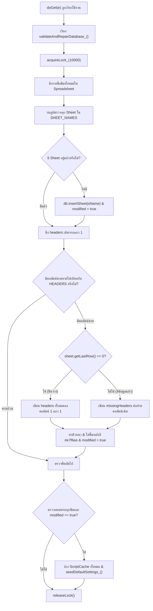

# 📘 REBUILD BLUEPRINT: Central Portal & SSO
## 01. โครงสร้างข้อมูล แกนกลางระบบ และการเชื่อมต่อ (Data Model & Core Backend)

> **เป้าหมายเอกสาร:** ใช้เป็นพิมพ์เขียวฉบับสมบูรณ์ (100% Behavioral & Storage Identity) สำหรับสร้างระบบ Central Portal & SSO ขึ้นมาใหม่ โดยมีโครงสร้างข้อมูล ตรรกะการประมวลผล กุญแจแคช และ API ตรงกับระบบเดิมทุกประการ (ส่วน UI/UX ให้โมเดลใหม่ออกแบบได้อิสระ)

---

### 1. แพลตฟอร์มและการติดตั้งระบบ (Platform & Deployment)

#### 1.1 ไฟล์การตั้งค่าโปรเจกต์ (`appsscript.json`)
ระบบทำงานบน Google Apps Script Runtime V8 โดยมีการกำหนดค่าตามมาตรฐานความปลอดภัยและสิทธิ์การเข้าถึงดังนี้:

```json
{
  "timeZone": "Asia/Bangkok",
  "dependencies": {
    "enabledAdvancedServices": [
      {
        "userSymbol": "Sheets",
        "serviceId": "sheets",
        "version": "v4"
      }
    ]
  },
  "exceptionLogging": "STACKDRIVER",
  "runtimeVersion": "V8",
  "oauthScopes": [
    "https://www.googleapis.com/auth/spreadsheets",
    "https://www.googleapis.com/auth/script.external_request",
    "https://www.googleapis.com/auth/script.send_mail",
    "https://www.googleapis.com/auth/drive",
    "https://www.googleapis.com/auth/script.scriptapp"
  ],
  "webapp": {
    "executeAs": "USER_DEPLOYING",
    "access": "ANYONE"
  }
}
```

- **Timezone:** `Asia/Bangkok` (GMT+7) ใช้สำหรับการจัดรูปแบบวันเวลาของระบบทั้งหมด
- **Advanced Service:** เปิดใช้งาน Google Sheets API V4 (`sheets:v4`)
- **Webapp Deployment Mode:**
  - `executeAs: "USER_DEPLOYING"` (รันในนามบัญชีของผู้ติดตั้ง เพื่อให้สามารถเข้าถึง Spreadsheet และ Google Drive กลางได้โดยที่ผู้ใช้ปลายทางไม่ต้องมีสิทธิ์แก้ Spreadsheet โดยตรง)
  - `access: "ANYONE"` (เปิดให้ทุกคนเข้าถึงหน้าเว็บแอปได้ โดยระบบจะควบคุมสิทธิ์การเข้าใช้งานผ่านชั้น Identity & Authentication ภายในแอปพลิเคชันเอง)

#### 1.2 สถาปัตยกรรมแยกส่วน Google Sheet และ GAS (Standalone GAS + Separate Google Sheet)
> [!CAUTION]
> **กฎการเชื่อมต่อฐานข้อมูลสำหรับโปรเจกต์ใหม่:**
> 1. **ห้ามใส่ URL ของฐานข้อมูลเดิม หรือ Script ID เดิมเด็ดขาด!**
> 2. **สร้างแยกระหว่าง Google Sheet และโปรเจกต์ GAS (Standalone Script):** โปรเจกต์ Google Apps Script แยกเป็นอิสระจากไฟล์ Google Sheets (ไม่ได้สร้างผ่านเมนู Extensions > Apps Script ในตัวชีต) เพื่อให้จัดการโค้ด ทำเป็น Library กลาง (`PortalAPI`) และควบคุมสิทธิ์แยกจากตัวไฟล์ฐานข้อมูลได้อย่างปลอดภัย
> 3. **ข้อมูลที่จะแจ้งภายหลังเมื่อเริ่มโปรเจกต์ใหม่:** ขณะเริ่มสร้างโปรเจกต์ใหม่ ผู้ใช้จะแจ้งค่าใหม่ (หรือให้ AI ถามผู้ใช้ก่อน Deploy) จำนวน 2 ค่า ได้แก่:
>    - **URL (หรือ ID) ของ Google Sheets ใบใหม่** -> นำไปใส่ในตัวแปร `DATABASE_URL` ในไฟล์ `Code.gs`
>    - **Script ID ของโปรเจกต์ GAS ใบใหม่** -> นำไปใส่ในไฟล์ `.clasp.json` (`{"scriptId": "<NEW_SCRIPT_ID>", "rootDir": "."}`)

- **ค่าคงที่ URL ของฐานข้อมูล (ใน `Code.gs`):**
  ```javascript
  // ใส่ URL ของไฟล์ Google Sheets ใบใหม่ที่ผู้ใช้จะแจ้งเมื่อเริ่มโปรเจกต์ใหม่ (ห้ามใช้ URL เดิม)
  const DATABASE_URL = 'PUT_NEW_GOOGLE_SHEET_URL_HERE';
  const APP_NAME = 'Central Portal & SSO';
  ```
- **ฟังก์ชันถอดรหัส Spreadsheet ID (`getDbId_()` สำหรับ Standalone GAS):**
  ดึง Spreadsheet ID ผ่าน Regular Expression จาก `DATABASE_URL` และเชื่อมต่อผ่าน `SpreadsheetApp.openById(getDbId_())` (หากยังไม่ได้ใส่ URL จริงจะแจ้งเตือนให้ใส่ก่อน):
  ```javascript
  function getDbId_() {
    var url = String(DATABASE_URL || '').trim();
    if (!url || url === 'PUT_NEW_GOOGLE_SHEET_URL_HERE') {
      throw new Error('กรุณาระบุ DATABASE_URL ของไฟล์ Google Sheets ใบใหม่ในไฟล์ Code.gs ก่อนเริ่มใช้งาน');
    }
    var match = url.match(/\/d\/([a-zA-Z0-9-_]+)/);
    return match ? match[1] : url;
  }
  ```

---

### 2. ค่าคงที่ระบบและโครงสร้างฐานข้อมูล (Global Constants & Complete Database Schema)

#### 2.1 รายชื่อชีตฐานข้อมูล (`SHEET_NAMES`)
```javascript
const SHEET_NAMES = {
  USERS: 'Users',
  PERSONNEL: 'Personnel',
  TOKENS: 'Security_Tokens',
  WEBAPPS: 'Webapps',
  PERMISSIONS: 'Permissions',
  SETTINGS: 'System_Settings',
  REFERENCE: 'Reference_Data',
  POSITION_STRUCTURE: 'Position_Structure'
};
```

#### 2.2 โครงสร้างคอลัมน์มาตรฐาน (`HEADERS`) สำหรับสร้างฐานข้อมูลใหม่ตั้งแต่ศูนย์
เมื่อรัน `RUN_SETUP_DATABASE()` หรือ `validateAndRepairDatabase_()` บนไฟล์ Google Sheets ใบใหม่ ระบบจะสร้างทั้ง 8 ตารางด้วยลำดับคอลัมน์ในแถวที่ 1 (Row 1) ที่รวมคอลัมน์ใช้งานจริงทั้งหมดไว้ครบถ้วนตั้งแต่ต้นดังนี้:

| Sheet Name | Standard Columns in `HEADERS` (สำหรับสร้างตารางใหม่) | คำอธิบายหน้าที่ของตาราง |
| :--- | :--- | :--- |
| **`Users`** | `Personnel_Ref_ID`, `Username`, `Email`, `Password_Salt`, `Password_Hash`, `Role`, `Status`, `Created_At`, `Updated_At`, `Last_Login_At`, `Username_Changed` | บัญชีผู้ใช้งาน รหัสผ่านที่แฮชแล้ว บทบาท และสถานะอนุมัติ |
| **`Personnel`** | `Personnel_ID`, `ID_Card_Number`, `Prefix`, `First_Name`, `Last_Name`, `Position_Type`, `Position`, `Position_Level`, `Position_2`, `Bureau_Name`, `Office`, `Department`, `Division`, `Start_Service_Year_BE`, `Current_Salary`, `Signature_URL`, `Photo_URL`, `Status`, `Created_At`, `Updated_At` | ทะเบียนประวัติบุคลากร ตำแหน่ง สังกัด 4 ระดับ และลิงก์รูป/ลายเซ็น |
| **`Security_Tokens`** | `Token_ID`, `User_ID`, `Token_Type`, `Token_String`, `Created_At`, `Expiry_Date`, `Is_Used`, `Ref_App_ID`, `Expires_At`, `Is_Active` | ตารางเก็บโทเค็น Session, ยืนยันอีเมล, รีเซ็ตรหัสผ่าน และ SSO Handshake |
| **`Webapps`** | `Webapp_ID`, `Name`, `URL`, `Icon_URL`, `Status`, `Description` | รายการเว็บแอปพลิเคชันลูกในเครือข่าย SSO |
| **`Permissions`** | `Personnel_Ref_ID`, `Webapp_ID`, `Access_Level` | สิทธิ์การเข้าใช้งานรายบุคคลต่อแต่ละเว็บแอปพลิเคชัน |
| **`System_Settings`** | `Key`, `Value`, `Description` | คู่คีย์-ค่าสำหรับการตั้งค่าระบบและโฟลเดอร์ Google Drive ใหม่ |
| **`Reference_Data`** | `Reference_ID`, `Type`, `Value`, `Short_Name`, `Parent_Type`, `Parent_Value`, `Sort_Order`, `Is_Active` | ข้อมูลตัวเลือก Dropdown และโครงสร้างหน่วยงานลำดับชั้นพร้อมชื่อย่อ (`Short_Name`) |
| **`Position_Structure`** | `Pos_ID`, `Position_Type`, `Position_Name`, `Position_Level`, `Sort_Order`, `Is_Active` | โครงสร้างประเภทตำแหน่ง ชื่อสายงาน และระดับตำแหน่ง |


#### 2.3 ค่าคงที่ Enums ของระบบ
- **ระดับสิทธิ์ผู้ใช้งาน (`ROLES`):**
  - `SUPERADMIN`: `'SUPERADMIN'` (สิทธิ์สูงสุด จัดการระบบ ดูแลผู้ใช้ และเข้าถึงทุกเว็บแอป)
  - `ADMIN`: `'ADMIN'` (ผู้ดูแลระบบ จัดการบุคลากร อนุมัติผู้ใช้ และกำหนดสิทธิ์)
  - `USER`: `'USER'` (ผู้ใช้งานทั่วไป เข้าถึงเฉพาะเว็บแอปที่ได้รับอนุญาต)
- **สถานะบัญชีผู้ใช้ (`USER_STATUS`):**
  - `VERIFY`: `'รอการยืนยันอีเมล'` (สมัครสมาชิกแล้ว รอการคลิกลิงก์ในอีเมล)
  - `PENDING`: `'รออนุมัติ'` (ยืนยันอีเมลแล้ว รอให้ Admin ตรวจสอบและอนุมัติ)
  - `ACTIVE`: `'ใช้งานปกติ'` (เข้าสู่ระบบและใช้งานได้ตามสิทธิ์)
  - `SUSPENDED`: `'ระงับบัญชี'` (ถูกบล็อก ไม่สามารถเข้าสู่ระบบได้)
- **ประเภทความปลอดภัยของโทเค็น (`TOKEN_TYPES`):**
  - `VERIFY_EMAIL`: `'VERIFY_EMAIL'` (โทเค็นยืนยันอีเมลหลังสมัครสมาชิก)
  - `RESET_PASSWORD`: `'RESET_PASSWORD'` (โทเค็นสำหรับตั้งรหัสผ่านใหม่)
  - `LOGIN_SESSION`: `'LOGIN_SESSION'` (โทเค็นเซสชันการเข้าสู่ระบบ)
  - `SSO_HANDSHAKE`: `'SSO_HANDSHAKE'` (โทเค็น Single-Use สำหรับส่งต่อผู้ใช้ไปยังแอปพลิเคชันลูก)

#### 2.4 การตั้งค่าระบบเริ่มต้น (`DEFAULT_SETTINGS`)
เมื่อสร้างฐานข้อมูลหรือเปิดระบบครั้งแรก รายการตั้งค่าเหล่านี้จะถูกเพิ่มลงชีต `System_Settings` อัตโนมัติ:

| Key | Default Value | Description |
| :--- | :--- | :--- |
| `App_Display_Name` | `ระบบ Central Portal & SSO (สตบ.สนท.)` | ชื่อเว็บแอพที่แสดงในหน้า Login และ Dashboard |
| `Verify_Email_Hours` | `24` | อายุลิงก์ยืนยันอีเมล หน่วยชั่วโมง |
| `Reset_Token_Minutes` | `15` | อายุลิงก์ลืมรหัสผ่าน หน่วยนาที |
| `Session_Hours` | `12` | อายุ session หลังเข้าสู่ระบบ หน่วยชั่วโมง |
| `Profile_Folder_ID` | `""` | Link หรือ ID โฟลเดอร์ Google Drive สำหรับเก็บรูปโปรไฟล์ User |
| `Signature_Folder_ID` | `""` | Link หรือ ID โฟลเดอร์ Google Drive สำหรับเก็บรูปลายเซ็น (Signature) |
| `Default_Profile_Picture_URL` | `""` | URL รูปโปรไฟล์เริ่มต้น สำหรับผู้ใช้/บุคลากรที่ยังไม่มีรูป |
| `App_Base_Url` | `""` | URL เว็บแอปหลัง deploy ใช้สร้างลิงก์อีเมล หากว่างจะใช้ URL ของ Apps Script |
| `Login_Logo_URL` | `""` | URL รูปโลโก้สำหรับหน้า Login |
| `Dashboard_Logo_URL` | `""` | URL รูปโลโก้สำหรับหน้า Dashboard/Sidebar |
| `Default_Theme` | `light` | ธีมเริ่มต้น light หรือ dark |

*หมายเหตุ: ใน Live Database มีคีย์เพิ่มเติมที่ถูกเพิ่มในภายหลัง ได้แก่ `Personnel_Photo_Folder_ID` และ `App_Icon_Folder_ID`*

---

### 3. แบบจำลองความสัมพันธ์และการจัดเก็บข้อมูล (Entity-Relationship & Storage Conventions)

#### 3.1 Primary Keys และ Foreign Keys
1. **`Users` Table:**
   - **PK:** `Personnel_Ref_ID` (ผูกตรงกับ `Personnel.Personnel_ID` แบบ 1:1)
2. **`Personnel` Table:**
   - **PK:** `Personnel_ID` (เช่น `PS0001`)
3. **`Security_Tokens` Table:**
   - **PK:** `Token_ID` (เช่น `TK0001`)
   - **FK:** `User_ID` (ชี้ไปยัง `Users.Personnel_Ref_ID`)
   - **FK:** `Ref_App_ID` (ชี้ไปยัง `Webapps.Webapp_ID` สำหรับ SSO Handshake)
4. **`Webapps` Table:**
   - **PK:** `Webapp_ID` (เช่น `APP0001` หรือ `WA0001`)
5. **`Permissions` Table:**
   - **Composite Key:** `(Personnel_Ref_ID, Webapp_ID)`
   - **FK:** `Personnel_Ref_ID` -> `Personnel.Personnel_ID`
   - **FK:** `Webapp_ID` -> `Webapps.Webapp_ID`
6. **`Reference_Data` Table:**
   - **PK:** `Reference_ID` (เช่น `REF0001`)
   - **Self-referencing:** `Parent_Type` และ `Parent_Value` สำหรับโครงสร้างลำดับชั้น เช่น Division เชื่อมกับ Department
7. **`Position_Structure` Table:**
   - **PK:** `Pos_ID` (เช่น `POS0001`)
8. **`System_Settings` Table:**
   - **PK:** `Key`

#### 3.2 กฎการสร้างรหัสเรียงลำดับอัตโนมัติ (`generateId_`)
อัลกอริทึมจะสแกนหาตัวเลขสูงสุดของคำนำหน้าในตาราง แล้วบวก 1 พร้อมจัดรูปแบบ Zero-padding 4 หลัก:
```javascript
function generateId_(prefix, sheetName, idField) {
  var data = readObjects_(getSheet_(sheetName));
  var maxId = 0;
  for (var i = 0; i < data.length; i++) {
    var idStr = String(data[i][idField] || '');
    if (idStr.indexOf(prefix) === 0) {
      var num = parseInt(idStr.replace(prefix, ''), 10);
      if (!isNaN(num) && num > maxId) maxId = num;
    }
  }
  var nextId = maxId + 1;
  var pad = '0000';
  return prefix + (pad + nextId).slice(-pad.length);
}
```

- **ตารางคำนำหน้ารหัส (Prefix Mapping):**
  - บุคลากร (`Personnel`): Prefix `'PS'` -> `PS0001`, `PS0002`, ...
  - ความปลอดภัย/โทเค็น (`Security_Tokens`): Prefix `'TK'` -> `TK0001`, `TK0002`, ...
  - เว็บแอปพลิเคชัน (`Webapps`): Prefix `'APP'` -> `APP0001`, `APP0002`, ...
  - ข้อมูลอ้างอิง/ตัวเลือก (`Reference_Data`): Prefix `'REF'` -> `REF0001`, `REF0002`, ...
  - สายงานและตำแหน่ง (`Position_Structure`): Prefix `'POS'` -> `POS0001`, `POS0002`, ...

#### 3.3 กฎการสร้าง Token สตริงสุ่ม (`generateTokenString_`)
สำหรับใช้เป็นโทเค็นเซสชัน, ยืนยันอีเมล, รีเซ็ตรหัสผ่าน, และ SSO:
```javascript
function generateTokenString_() {
  return 'tk_' + Utilities.getUuid().replace(/-/g, '') + Date.now().toString(36);
}
```

#### 3.4 กฎการจัดรูปแบบวันเวลาและค่าบูลีน
- **วันเวลา (`nowText_`):** คืนค่าสตริงรูปแบบ `yyyy-MM-dd HH:mm:ss` ในเขตเวลา `Asia/Bangkok` เสมอ
- **วันที่ (`toIsoDate_`):** คืนค่าสตริงรูปแบบ `YYYY-MM-DD` (`toISOString().split('T')[0]`)
- **ค่าบูลีนในตาราง:** จัดเก็บเป็นสตริงตัวพิมพ์ใหญ่ `'TRUE'` หรือ `'FALSE'` เสมอ (เช่น `Is_Active`, `Is_Used`, `Username_Changed`)

---

### 4. ชั้นการเข้าถึงและแคชข้อมูล (Data Access & Caching Layer - `Data.gs`)

#### 4.1 ตัวแปรแคชในหน่วยความจำระดับ Request
- `let REQUEST_CACHE = {};`
- เก็บ Object ของ `REQUEST_CACHE.db` เพื่อเปิด Spreadsheet เพียงครั้งเดียวตลอด Execution

#### 4.2 การเชื่อมต่อฐานข้อมูลและการเลือกชีต
- `getDatabase_()`: ตรวจสอบและดึง `REQUEST_CACHE.db` หากยังไม่มีจะเรียก `SpreadsheetApp.openById(getDbId_())`
- `getSheet_(sheetName)`: ดึง Sheet ตามชื่อ หากไม่พบจะโยน Exception:
  ```javascript
  if (!sheet) throw new Error('ไม่พบฐานข้อมูล: ' + sheetName);
  ```

#### 4.3 การอ่านข้อมูลพร้อมระบบแคช ScriptCache (`readObjects_`)
- **Key ของแคช:** `'DB_' + sheetName`
- **ระยะเวลาแคช (TTL):** `21600` วินาที (เท่ากับ 6 ชั่วโมงเต็ม)
- **อัลกอริทึม:**
  1. หากไม่ได้สั่ง `forceFresh = true` จะค้นหาจาก `CacheService.getScriptCache().get(cacheKey)` ก่อน ถ้าพบจะแปลง JSON ส่งกลับทันที
  2. หากไม่มีในแคช จะอ่านจาก `sheet.getDataRange().getDisplayValues()`
  3. หากข้อมูลมีน้อยกว่า 2 แถว (มีเฉพาะหัวตารางหรือว่างเปล่า) จะคืนค่า `[]`
  4. นำแถวที่ 1 มาใช้เป็น Header Name แมปค่าคอลัมน์ของทุกแถว
  5. ฉีดพร็อพเพอร์ตี้พิเศษ `_row: i + 1` (1-based row index) เพื่อใช้ในการอ้างอิงพิกัดแก้ไข/ลบ
  6. บันทึกข้อมูล JSON ลง ScriptCache ด้วย TTL 21,600 วินาที

#### 4.4 การล้างแคช (`invalidateCache_`)
```javascript
function invalidateCache_(sheetName) {
  var cacheKey = 'DB_' + sheetName;
  CacheService.getScriptCache().remove(cacheKey);
}
```

#### 4.5 การเพิ่ม แก้ไข และลบข้อมูล
- `appendObject_(sheetName, obj)`:
  - อ่าน Header แถวที่ 1 จากชีตจริงแบบไดนามิก
  - จัดเรียงค่าของ `obj` ตามลำดับคอลัมน์ (ค่าว่างจะใส่ `''`)
  - สั่ง `sheet.appendRow(row)`
  - สั่ง `invalidateCache_(sheetName)` ทันที
  - คืนค่าแถวล่าสุด `sheet.getLastRow()`
- `updateObjectAtRow_(sheetName, rowIdx, updateObj)`:
  - อ่าน Header และค่าเดิมของแถวที่ `rowIdx`
  - ตรวจสอบความแตกต่างทีละคอลัมน์ หากพบค่าที่เปลี่ยนจะปรับค่าใน Array และตั้ง `hasChange = true`
  - หากมีค่าเปลี่ยน จะเขียนทับเฉพาะแถวนั้นด้วย `sheet.getRange(rowIdx, 1, 1, headers.length).setValues([rowData])`
  - สั่ง `invalidateCache_(sheetName)` ทันที
  - คืนค่า `true`
- `deleteRow_(sheetName, rowIdx)`:
  - เรียก `sheet.deleteRow(rowIdx)`
  - สั่ง `invalidateCache_(sheetName)` ทันที
  - คืนค่า `true`
- `findById_(sheetName, idField, idValue)`:
  - อ่านข้อมูลผ่าน `readObjects_` แล้วเทียบ `String(data[i][idField]) === String(idValue)`
  - คืน Object พร้อม `_row` หรือคืนค่า `null` หากไม่พบ

#### 4.6 การจัดการ Concurrency และ Script Lock (`acquireLock_`)
- ใช้ `LockService.getScriptLock()` รอ Lock สูงสุด 10,000 มิลลิวินาที (10 วินาที)
- หากไม่สามารถขอ Lock ได้ จะโยนข้อความภาษาไทย:
  ```javascript
  function acquireLock_(timeout) {
    var lock = LockService.getScriptLock();
    try {
      lock.waitLock(timeout || 10000);
      return lock;
    } catch (e) {
      throw new Error('ระบบไม่ว่าง กำลังมีผู้ใช้งานอื่นบันทึกข้อมูล โปรดลองใหม่ในภายหลัง');
    }
  }
  ```

#### 4.7 ยูทิลิตีระบบ
- `getSetting_(key, def)`: อ่านค่าการตั้งค่าจากชีต `System_Settings` หากไม่มีหรือว่างเปล่าจะคืนค่า `def`
- `buildFullName_(prefix, first, last)`: รวมชื่อ-นามสกุลตามไวยากรณ์ไทยเป๊ะๆ:
  - หาก `prefix` เป็น `'นาย'`, `'นาง'`, หรือ `'นางสาว'`: **ไม่เว้นวรรค**ระหว่างคำนำหน้ากับชื่อจริง เช่น `"นายสมชาย ใจดี"`, `"นางสาวสมศรี มณีฉาย"` (`p + f + ' ' + l`)
  - หาก `prefix` เป็นยศ ตำแหน่งทางวิชาการ หรืออื่นๆ: **เว้นวรรค 1 เคาะ** เช่น `"ดร. สมชาย ใจดี"`, `"พ.ต.อ. สมเกียรติ ยั่งยืน"` (`p + ' ' + f + ' ' + l`)
  - หากไม่มีคำนำหน้า: ตัดช่องว่างและคืนค่า `(f + ' ' + l).trim()`
- `assertRequired_(payload, fields)`: ตรวจสอบความถูกต้องของข้อมูล หากฟิลด์ใดเป็น `undefined`, `null` หรือข้อความว่าง จะโยน Error:
  ```javascript
  throw new Error('กรุณากรอกข้อมูล: ' + f);
  ```

---

### 5. ระบบซ่อมแซมฐานข้อมูลอัตโนมัติ (Database Auto-Healing Engine)

ฟังก์ชัน `validateAndRepairDatabase_()` ทำงานอัตโนมัติเมื่อมี HTTP GET Request เข้ามายังระบบ โดยมีขั้นตอนการทำงานอย่างเป็นระบบ:



- **การ Seed ค่าตั้งค่า (`seedDefaultSettings_`):**
  - อ่านชีต `System_Settings` หากพบว่าคีย์ใดใน `DEFAULT_SETTINGS` ยังไม่มี จะทำการ `appendRow(set)` ลงในชีตทันที พร้อมเรียก `invalidateCache_('System_Settings')`

---

### 6. จุดเข้าถึงผ่านเครือข่าย HTTP (HTTP & RPC Entry Points - `Code.gs`)

#### 6.1 `doGet(e)` Entry Point
รองรับ 3 พฤติกรรมหลัก:
1. **ยืนยันอีเมล (`action === 'verifyEmail'`):**
   - เรียก `handleVerifyEmail_(p.token)`
   - ค้นหา Token ใน `Security_Tokens` (ประเภท `VERIFY_EMAIL`, `Is_Used !== 'TRUE'`, ไม่หมดอายุ)
   - ปรับสถานะ User ในตาราง `Users` เป็น `USER_STATUS.PENDING` (`'รออนุมัติ'`)
   - ปรับสถานะ Token เป็น `Is_Used = 'TRUE'`
   - เรนเดอร์หน้า `Index.html` พร้อม `template.initialMode = 'verify-success'` หรือ `'verify-error'`
2. **เปลี่ยนเส้นทาง SSO อัตโนมัติ (`action === 'ssoRedirect'`):**
   - เรียก `handleSsoRedirect_(p.token, p.target)`
   - ตรวจสอบ Session Token ของผู้ใช้ผ่าน `verifySession_(tokenString)`
   - ค้นหาแอปเป้าหมายในชีต `Webapps` (ต้องมีสถานะเป็น `ACTIVE` หรือ `เปิดใช้งาน`)
   - ตรวจสอบสิทธิ์ในชีต `Permissions` (หากไม่ใช่ Super Admin ต้องมีสิทธิ์อย่างน้อย `USER` หรือ `ADMIN`)
   - สร้าง Single-Use SSO Handshake Token อายุ 5 นาที
   - ส่งกลับหน้าเว็บขนาดเล็กที่เปลี่ยนเส้นทางผ่าน Javascript:
     ```html
     <script>window.top.location.href = "URL?ssoToken=...&sso_token=...";</script>
     ```
     พร้อมลิงก์สำรองให้ผู้ใช้คลิกเองหากเบราว์เซอร์ไม่เปลี่ยนหน้าอัตโนมัติ
3. **โหลดแอปพลิเคชันหลัก (SPA Normal Boot):**
   - โหลด `Index.html` ผ่าน `HtmlService.createTemplateFromFile('Index')`
   - อ่านการตั้งค่าทั้งหมดจาก `System_Settings` ฉีดลง `template.initialSettings` พร้อมแนบ `scriptUrl = ScriptApp.getService().getUrl()`
   - ส่งต่อค่าพารามิเตอร์ `template.initialMode = p.mode || ''` และ `template.initialToken = p.token || ''`
   - ตั้งค่า Title เป็น `APP_NAME`, Viewport Responsive, และกำหนด `.setXFrameOptionsMode(HtmlService.XFrameOptionsMode.ALLOWALL)`

#### 6.2 `doPost(e)` JSON API Contract
รองรับการยิง REST/JSON API จากภายนอก:
- **Input:** JSON String ใน `e.postData.contents`:
  ```json
  {
    "action": "auth.login",
    "payload": { "username": "...", "password": "..." },
    "token": "..."
  }
  ```
- **Output:** JSON String รูปแบบมาตรฐาน MIME `application/json`:
  ```json
  {
    "success": true,
    "data": {},
    "error": null
  }
  ```
  หากเกิดข้อผิดพลาดจะส่งกลับ:
  ```json
  {
    "success": false,
    "data": null,
    "error": "ข้อความอธิบายความผิดพลาด"
  }
  ```

#### 6.3 `processClientRequest(reqStr)` RPC Contract
เป็นฟังก์ชันหลักที่ Client-side เรียกใช้งานผ่าน `google.script.run`:
- รับค่าสตริง JSON `{ action, payload, token }`
- ส่งต่อไปยัง `apiHandler_(req.action, req.payload || {}, req.token || null)`
- ส่งกลับ Object `{ success: true, data: ..., error: null }` หรือ `{ success: false, data: null, error: err.message }`

#### 6.4 `include(filename)`
- ฟังก์ชันสำหรับแทรกเนื้อหาของไฟล์ HTML ย่อย (เช่น CSS, Javascript, View ต่างๆ) ลงในเทมเพลตหลัก:
  ```javascript
  function include(filename) {
    return HtmlService.createHtmlOutputFromFile(filename).getContent();
  }
  ```

---

### 7. ตารางจับคู่ API เส้นทางคำสั่ง (Complete API Router Table - `apiHandler_`)

คำสั่งทั้งหมดที่ส่งเข้ามายังระบบผ่าน `action` จะถูกกระจายงานผ่าน `switch(action)` ดังนี้:

| Action String | Target Function | Role / Session Requirement | Input Payload | Return Value / Data Structure |
| :--- | :--- | :--- | :--- | :--- |
| `auth.verifySSOToken` | `verifySSOToken_` | Public (Handshake Token) | `{ ssoToken }` | User & Personnel Profile Payload |
| `auth.generateSSOToken` | `generateSSOToken_` | User Session (`requireSession_`) | `{ webappId }` | `{ ssoToken }` |
| `auth.login` | `loginUser_` | Public | `{ username, password }` | `{ message, token, role, userId, mustChangeUsername }` |
| `auth.register` | `registerUser_` | Public | ข้อมูลลงทะเบียน | `{ message: 'ลงทะเบียนสำเร็จ...' }` |
| `auth.searchPersonnelForRegister` | `searchPersonnelForRegister_` | Public | `{ idCard, firstName, lastName }` | Array ของข้อมูลบุคลากรที่ค้นพบ |
| `auth.getRegistrationDropdowns` | Inline Dispatch | Public | `{}` | `{ references: [...], positions: [...] }` |
| `auth.checkAccountExists` | `checkAccountExists_` | Public | `{ personnelId }` | `{ exists: Boolean, email: String, message: String }` |
| `auth.requestReset` | `requestPasswordReset_` | Public | `{ email }` | `{ message: 'ลิงก์รีเซ็ตรหัสผ่านถูกส่ง...' }` |
| `auth.resetPassword` | `resetPassword_` | Public | `{ token, newPassword }` | `{ message: 'ตั้งรหัสผ่านใหม่สำเร็จ' }` |
| `auth.verifySession` | `requireSession_` | User Session (`requireSession_`) | `{}` | Session User Object พร้อมข้อมูลบุคลากร |
| `auth.logout` | `logoutUser_` | User Session (`requireSession_`) | `{}` | `{ success: true }` |
| `auth.changePassword` | `changePassword_` | User Session (`requireSession_`) | `{ oldPassword, newPassword }` | `{ message: 'เปลี่ยนรหัสผ่านสำเร็จ' }` |
| `auth.updateMyProfile` | `updateMyProfile_` | User Session (`requireSession_`) | `{ Email, Password, Photo_Base64, Signature_Base64 }` | `{ message: 'บันทึกข้อมูลส่วนตัวสำเร็จ' }` |
| `dashboard.apps` | `getDashboardApps_` | User Session (`requireSession_`) | `{}` | Array ของ Webapps ที่ผู้ใช้มีสิทธิ์เข้าถึง |
| `users.list` | `listUsers_` | Admin (`admin: true`) | `{}` | Array ของผู้ใช้ทั้งหมดพร้อมข้อมูลบุคลากร |
| `users.create` | `createUser_` | Admin (`admin: true`) | `{ Personnel_Ref_ID, Username, Email, Password, Role, Status, ... }` | `{ message: 'สร้างบัญชีผู้ใช้ใหม่สำเร็จ', id: pId }` |
| `users.save` | `saveUser_` | Admin (`admin: true`) | `{ Personnel_Ref_ID, Role, Status, newPassword }` | `{ message: 'อัปเดตบัญชีผู้ใช้สำเร็จ' }` |
| `users.delete` | `deleteUser_` | Superadmin (`superadmin: true`) | `{ Personnel_Ref_ID }` | `{ message: 'ลบบัญชีสำเร็จ' }` |
| `personnel.list` | `listPersonnel_` | Admin (`admin: true`) | `{}` | Array ของบุคลากรทั้งหมด (เรียงแถวล่าสุดขึ้นก่อน) |
| `personnel.searchUnregistered` | `searchUnregisteredPersonnel_` | Admin (`admin: true`) | `{ Query }` | Array ของบุคลากรที่ยังไม่มีบัญชีผู้ใช้ |
| `personnel.save` | `savePersonnel_` | User Session (แก้เฉพาะตนเอง) หรือ Admin | ข้อมูลบุคลากร (พร้อมรูปถ่าย/ลายเซ็น Base64) | `{ message: 'บันทึกข้อมูลบุคลากรสำเร็จ', id: pId }` |
| `personnel.delete` | `deletePersonnel_` | Admin (`admin: true`) | `{ Personnel_ID }` | `{ message: 'ลบข้อมูลบุคลากรสำเร็จ' }` |
| `webapps.list` | `listWebapps_` | Admin (`admin: true`) | `{}` | Array ของ Webapps ทั้งหมด |
| `webapps.save` | `saveWebapp_` | Superadmin (`superadmin: true`) | `{ Webapp_ID, Name, URL, Icon_URL, Status, Description }` | `{ message: 'บันทึกแอปพลิเคชันสำเร็จ' }` |
| `webapps.delete` | `deleteWebapp_` | Superadmin (`superadmin: true`) | `{ Webapp_ID }` | `{ message: 'ลบแอปพลิเคชันสำเร็จ' }` |
| `permissions.get` | `getUserPermissions_` | Admin (`admin: true`) | `{ Personnel_Ref_ID }` | Array ของสิทธิ์ผู้ใช้ในแต่ละ Webapp |
| `permissions.save` | `saveUserPermissions_` | Admin (`admin: true`) | `{ Personnel_Ref_ID, Permissions: [{ Webapp_ID, Access_Level }] }` | `{ message: 'บันทึกสิทธิ์สำเร็จ' }` |
| `references.list` | `listReferences_` | User Session (`requireSession_`) | `{}` | Array ของข้อมูล Dropdown ทั้งหมด |
| `references.save` | `saveReference_` | Admin (`admin: true`) | `{ Reference_ID, Type, Value, Short_Name, Parent_Type, Parent_Value, Sort_Order, Is_Active }` | `{ message: 'บันทึกข้อมูลสำเร็จ' }` |
| `references.delete` | `deleteReference_` | Admin (`admin: true`) | `{ Reference_ID }` | `{ message: 'ลบข้อมูลสำเร็จ' }` |
| `positions.list` | `listPositions_` | Admin (`admin: true`) | `{}` | Array ของโครงสร้างตำแหน่งทั้งหมด |
| `positions.save` | `savePosition_` | Admin (`admin: true`) | `{ Pos_ID, Position_Type, Position_Name, Position_Level, Sort_Order, Is_Active }` | `{ message: 'บันทึกตำแหน่งสำเร็จ' }` |
| `positions.delete` | `deletePosition_` | Admin (`admin: true`) | `{ Pos_ID }` | `{ message: 'ลบตำแหน่งสำเร็จ' }` |
| `settings.get` | `getSettingsForClient_` | Superadmin (`superadmin: true`) | `{}` | `{ settings: [...], cronJobActive: Boolean }` |
| `settings.update` | `updateSettings_` | Superadmin (`superadmin: true`) | `{ settings: [{ Key, Value }] }` | `{ message: 'บันทึกการตั้งค่าสำเร็จ' }` |
| `settings.testDriveLink` | `testDriveLink_` | Superadmin (`superadmin: true`) | `{ url }` (Folder ID หรือ Drive Link) | `{ ok: true, message: 'การเชื่อมต่อสำเร็จ...' }` |
| `settings.setupCron` | `setupCron_` | Superadmin (`superadmin: true`) | `{}` | `{ message: 'ตั้งค่าระบบล้างขยะอัตโนมัติเรียบร้อยแล้ว' }` |
| `notifications.get` | `getNotifications_` | User Session / Admin | `{}` | Array รายการแจ้งเตือนผู้ใช้รออนุมัติ |

---

### 8. ฟังก์ชันสาธารณะสำหรับเชื่อมต่อผ่าน GAS Library (Public Library Interface)

ฟังก์ชันระดับ Global ใน `Code.gs` และ `Auth.gs` สำหรับให้เว็บแอปพลิเคชันภายนอก (เช่น Vehicle App, Car Request App) เรียกใช้งานผ่าน Library (`PortalAPI`) หรือ Apps Script API:

1. **`verifySSOToken(ssoToken)`:**
   - รับค่าโทเค็นสตริงจาก URL พารามิเตอร์ `?ssoToken=...` หรือ `?sso_token=...`
   - ตรวจสอบความถูกต้องในชีต `Security_Tokens` (ประเภท `SSO_HANDSHAKE`, อายุ 5 นาที, และ `Is_Used !== 'TRUE'`)
   - ปรับสถานะเป็น `Is_Used = 'TRUE'` ทันทีเพื่อป้องกันการนำโทเค็นมาใช้ซ้ำ (Single-Use Token)
   - ส่งคืน Payload ข้อมูลผู้ใช้และข้อมูลบุคลากรแบบสมบูรณ์ ซึ่งมีทั้งฟิลด์ PascalCase ดั้งเดิม และฟิลด์ camelCase สำหรับระบบลูก
2. **`getPersonnelList()`:**
   - คืนค่ารายชื่อและข้อมูลบุคลากรทั้งหมดในชีต `Personnel` (ผ่านแคช ScriptCache 6 ชั่วโมง)
3. **`getReferenceData()`:**
   - คืนค่าข้อมูลตัวเลือก ดรอปดาวน์ และสังกัดหน่วยงานทั้งหมดในชีต `Reference_Data` (ผ่านแคช 6 ชั่วโมง)
4. **`getPositionStructure()`:**
   - คืนค่าโครงสร้างสายงานและระดับตำแหน่งทั้งหมดในชีต `Position_Structure` (ผ่านแคช 6 ชั่วโมง)
5. **`getPublicConfig()`:**
   - ฟังก์ชันช่องทางดึงการตั้งค่าสาธารณะของระบบที่เผยแพร่ให้แอปพลิเคชันภายนอกใช้งาน

---

### 9. สคริปต์สำหรับการบำรุงรักษาและติดตั้งระบบ (`Migration.gs`)

ฟังก์ชันสำหรับการรันด้วยตนเองจาก Apps Script Editor ระหว่างการติดตั้ง ทดสอบ หรือย้ายระบบ:

1. **`RUN_SETUP_DATABASE()`:**
   - เรียกใช้ `validateAndRepairDatabase_()` เพื่อตรวจสอบและสร้างชีตที่ขาดหาย เติมคอลัมน์มาตรฐาน และ Seed ค่าเริ่มต้นลงใน `System_Settings`
2. **`RUN_CLEAR_CACHE()`:**
   - ล้าง ScriptCache ของทุกชีตใน `SHEET_NAMES`
3. **`RUN_CREATE_SUPERADMIN()`:**
   - สร้างบัญชี Super Admin ฉุกเฉินแบบอัตโนมัติ (`Username: 'superadmin'`, `Email: 'admin@example.com'`, รหัสผ่าน `'password123'`, `Role: 'SUPERADMIN'`, `Status: 'ใช้งานปกติ'`)
4. **`migratePersonnelIdColumn()`:**
   - ตรวจสอบเซลล์ `A1` ของชีต `Personnel` หากยังเป็น `'ID'` จะเปลี่ยนชื่อเป็น `'Personnel_ID'`
5. **`RUN_MIGRATE_PHASE3()`:**
   - สั่งรัน `validateAndRepairDatabase_()` เพื่ออัปเกรดโครงสร้างฐานข้อมูลสำหรับ Phase 3 (เติมคอลัมน์ `Short_Name` ใน `Reference_Data`)
6. **`checkDB()`:**
   - ตรวจสอบสถานะการเชื่อมต่อชีต `Personnel` และพิมพ์ Header รวมถึงแถวแรกออกมาทาง `console.log`

