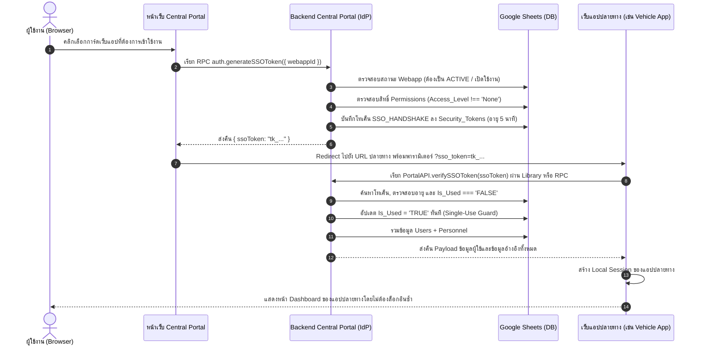

# 📘 REBUILD BLUEPRINT: Central Portal & SSO
## 02. สถาปัตยกรรมระบบยืนยันตัวตนและการเชื่อมต่อข้ามระบบ (Authentication & SSO Blueprint)

> **เป้าหมายเอกสาร:** พิมพ์เขียวทางเทคนิคฉบับสมบูรณ์สำหรับระบบยืนยันตัวตน (Authentication), การจัดการเซสชัน (Session Lifecycle), การสมัครสมาชิกและจับคู่บุคลากร (Registration & Personnel Matching), การกู้คืนรหัสผ่าน (Password Reset) และระบบ Single Sign-On (SSO Handshake) ของ **Central Portal & SSO (`portal-apps-script`)** เพื่อให้ AI สามารถนำไปสร้างใหม่ได้ตรงตามพฤติกรรมเดิม 100%

---

## 1. สถาปัตยกรรมตารางความปลอดภัย (`Security_Tokens` Architecture)

ตาราง `Security_Tokens` ใน Google Sheets ทำหน้าที่เป็นศูนย์กลางจัดเก็บโทเค็นความปลอดภัยทุกประเภทในระบบ ไม่ว่าจะเป็นเซสชันการล็อกอิน, การยืนยันอีเมล, การรีเซ็ตรหัสผ่าน, หรือบัตรผ่าน SSO ข้ามเว็บแอป

### 1.1 ประเภทโทเค็น (`TOKEN_TYPES`)
ระบบกำหนดค่าคงที่ประเภทโทเค็นไว้ใน `Code.gs` และ `Auth.gs` จำนวน 4 ประเภท:
1. `LOGIN_SESSION` (`"LOGIN_SESSION"`): เซสชันการเข้าสู่ระบบของผู้ใช้ รองรับการใช้งานต่อเนื่องตลอดอายุ TTL
2. `VERIFY_EMAIL` (`"VERIFY_EMAIL"`): โทเค็นยืนยันอีเมลเมื่อลงทะเบียนบัญชีใหม่หรือเปลี่ยนอีเมล (ใช้งานได้ครั้งเดียว - Single-Use)
3. `RESET_PASSWORD` (`"RESET_PASSWORD"`): โทเค็นสำหรับกู้คืนรหัสผ่านทางอีเมล (ใช้งานได้ครั้งเดียว - Single-Use)
4. `SSO_HANDSHAKE` (`"SSO_HANDSHAKE"`): บัตรผ่านสำหรับกระโดดข้ามไปยังแอปพลิเคชันปลายทาง (อายุสั้น 5 นาที และใช้งานได้ครั้งเดียว - Single-Use)

### 1.2 โครงสร้างคอลัมน์และการบันทึกข้อมูล
ตามนิยามส่วนหัวคอลัมน์ใน `Code.gs` (`HEADERS.Security_Tokens`) และการเรียกใช้ใน `Auth.gs`:

| ลำดับ | ชื่อคอลัมน์ | ชนิดข้อมูล | ตัวอย่างค่า | คำอธิบาย |
| :--- | :--- | :--- | :--- | :--- |
| 1 | `Token_ID` | String | `TK0001` | รหัสโทเค็นลำดับ รันอัตโนมัติด้วยฟังก์ชัน `generateId_('TK', SHEET_NAMES.TOKENS, 'Token_ID')` ความยาว 4 หลัก |
| 2 | `User_ID` | String | `PS0001` | อ้างอิงรหัสบุคลากร (`Personnel_Ref_ID` / `Personnel_ID`) ของเจ้าของบัญชี |
| 3 | `Token_Type` | String | `LOGIN_SESSION` | หนึ่งใน 4 ค่าของ `TOKEN_TYPES` |
| 4 | `Token_String` | String | `tk_9b1deb4d...` | สตริงสุ่มความปลอดภัย สร้างจาก `generateTokenString_()` |
| 5 | `Created_At` | String | `2026-10-18 08:30:00` | วันเวลาที่สร้าง ฟอร์แมต `yyyy-MM-dd HH:mm:ss` (Timezone: `Asia/Bangkok`) ผ่าน `nowText_()` |
| 6 | `Expiry_Date` / `Expires_At` | String | `2026-10-18 20:30:00` | วันเวลาที่หมดอายุ ฟอร์แมต `yyyy-MM-dd HH:mm:ss` (หมายเหตุ: ใน Live Sheet มีทั้ง `Expiry_Date` และ `Expires_At` โดยโค้ดใน `Auth.gs` อ่าน/เขียนที่คอลัมน์ `Expiry_Date`) |
| 7 | `Is_Used` / `Is_Active` | String | `FALSE` หรือ `TRUE` | สถานะการใช้งาน เริ่มต้นบันทึกเป็น `'FALSE'` ในคอลัมน์ `Is_Used` และเปลี่ยนเป็น `'TRUE'` เมื่อถูกใช้งานหรือยกเลิก |
| 8 | `Ref_App_ID` | String | `WA0001` หรือ `""` | อ้างอิงรหัสแอปปลายทาง (`Webapp_ID`) เมื่อเป็นโทเค็นชนิด `SSO_HANDSHAKE` หากไม่ใช่จะเป็นค่าว่าง |

### 1.3 อายุการใช้งาน (TTL) และการตั้งค่าระบบ (`System_Settings`)
อายุของแต่ละโทเค็นจะถูกดึงมาจากตาราง `System_Settings` ผ่านฟังก์ชัน `getSetting_(key, defaultVal)`:

- **Session อายุการล็อกอิน (`LOGIN_SESSION`):**
  - ดึงค่าจาก Key: `Session_Hours` (ค่าเริ่มต้น: `12` ชั่วโมง)
  - คำนวณวันหมดอายุ: `exp.setHours(exp.getHours() + sessionHours)`
  - สิทธิ์การใช้งาน: Multi-use ภายในอายุ TTL จนกว่าจะกด Logout หรือถูกสั่งตัดสิทธิ์
  - แคชความเร็วสูง: เมื่อตรวจสอบผ่านจะถูกบันทึกลง `CacheService.getScriptCache()` นาน 3,600 วินาที (1 ชั่วโมง) เพื่อลดการอ่านฐานข้อมูลซ้ำซ้อน
- **อายุลิงก์ยืนยันอีเมล (`VERIFY_EMAIL`):**
  - ดึงค่าจาก Key: `Verify_Email_Hours` (ค่าเริ่มต้น: `24` ชั่วโมง)
  - คำนวณวันหมดอายุ: `exp.setHours(exp.getHours() + expHours)`
  - สิทธิ์การใช้งาน: Single-use (เมื่อคลิกลิงก์และยืนยันสำเร็จจะปรับ `Is_Used = 'TRUE'` ทันที)
- **อายุลิงก์รีเซ็ตรหัสผ่าน (`RESET_PASSWORD`):**
  - กำหนดไว้ใน Key: `Reset_Token_Minutes` (ค่าเริ่มต้น: `15` นาที) ใน `DEFAULT_SETTINGS` (และมี Fallback 1 ชั่วโมงใน `requestPasswordReset_`)
  - สิทธิ์การใช้งาน: Single-use
- **อายุบัตรผ่าน SSO (`SSO_HANDSHAKE`):**
  - อายุคงที่: 5 นาที (`exp.setMinutes(exp.getMinutes() + 5)`)
  - สิทธิ์การใช้งาน: Single-use อย่างเข้มงวด เมื่อแอปปลายทางตรวจยืนยันสำเร็จจะถูกเปลี่ยนเป็น `Is_Used = 'TRUE'` ทันทีเพื่อป้องกัน Replay Attack

---

## 2. อัลกอริทึมการเข้ารหัสลับรหัสผ่านและสร้างโทเค็น (Cryptography & Token Generation)

### 2.1 อัลกอริทึมแฮชรหัสผ่าน `hashPassword_(password, salt)`
ระบบใช้มาตรฐาน **Salted SHA-256** โดยคำนวณผ่าน Google Apps Script `Utilities.computeDigest`:

1. **การรวมสตริงก่อนแฮช (Payload Order):**
   - นำ `salt` ตามด้วยตัวคั่นเครื่องหมายไปป์ (`|`) และตามด้วย `password`
   - รูปแบบ: `String(salt) + '|' + String(password)`
2. **การเข้ารหัสชุดอักขระ (Charset):**
   - ใช้ `Utilities.Charset.UTF_8`
3. **การแปลง Signed Byte เป็น Hexadecimal (Byte-to-Hex Mapping):**
   - เนื่องจาก `computeDigest` ของ Java/Apps Script ส่งคืนค่า Byte แบบ Signed (-128 ถึง 127) จึงต้องแปลงค่าลบให้เป็น Unsigned (0 ถึง 255) ด้วยสูตร: `(byte < 0) ? 256 + byte : byte`
   - จากนั้นแปลงเป็นฐาน 16 (Hex) 2 หลัก พร้อมเติมศูนย์ข้างหน้า: `('0' + v.toString(16)).slice(-2)`
   - รวมเป็นสตริง Hex ความยาว 64 ตัวอักษรพิมพ์เล็ก (Lowercase)

```javascript
function hashPassword_(password, salt) {
  var digest = Utilities.computeDigest(
    Utilities.DigestAlgorithm.SHA_256,
    String(salt) + '|' + String(password),
    Utilities.Charset.UTF_8
  );
  return digest.map(function(byte) {
    var v = (byte < 0) ? 256 + byte : byte;
    return ('0' + v.toString(16)).slice(-2);
  }).join('');
}
```

### 2.2 อัลกอริทึมสร้างสตริงโทเค็น `generateTokenString_()`
โทเค็นสร้างขึ้นโดยผสมผสาน 3 องค์ประกอบเข้าด้วยกัน:
1. คำนำหน้า: `'tk_'`
2. UUID สุ่มแบบไม่มีขีดคั่น: `Utilities.getUuid().replace(/-/g, '')` (32 ตัวอักษร Hex)
3. ค่าประทับเวลาปัจจุบันแปลงเป็นฐาน 36: `Date.now().toString(36)`

```javascript
function generateTokenString_() {
  return 'tk_' + Utilities.getUuid().replace(/-/g, '') + Date.now().toString(36);
}
```

---

## 3. วงจรชีวิตของเซสชันผู้ใช้งาน (Session Lifecycle)

### 3.1 การเข้าสู่ระบบ (`loginUser_(payload)`)
- **การตรวจสอบข้อมูลเบื้องต้น:** ตรวจสอบว่าส่ง `username` และ `password` เข้ามาครบถ้วนผ่าน `assertRequired_(payload, ['username', 'password'])`
- **การค้นหาบัญชี (Case-Insensitive):**
  - ตัดช่องว่างและแปลงเป็นตัวพิมพ์เล็ก: `var username = String(payload.username).trim().toLowerCase()`
  - เปรียบเทียบกับตาราง `Users` ทั้งคอลัมน์ `Username` และ `Email` (ผู้ใช้สามารถล็อกอินด้วยชื่อผู้ใช้หรืออีเมลก็ได้):
    `users[i].Username.toLowerCase() === username || users[i].Email.toLowerCase() === username`
  - หากไม่พบบัญชี: ส่งข้อผิดพลาดภาษาไทย `Error('ชื่อผู้ใช้หรือรหัสผ่านไม่ถูกต้อง')`
- **การตรวจสอบสถานะบัญชี (Status Guard - ตรวจสอบตามลำดับ):**
  1. หาก `user.Status === 'รอการยืนยันอีเมล'`: โยนข้อผิดพลาด `Error('บัญชีนี้ยังไม่ได้รับการยืนยันอีเมล')`
  2. หาก `user.Status === 'รออนุมัติ'`: โยนข้อผิดพลาด `Error('บัญชีนี้กำลังรอการอนุมัติจากผู้ดูแลระบบ')`
  3. หาก `user.Status === 'ระงับบัญชี'` หรือ `'ระงับการใช้งาน'`: โยนข้อผิดพลาด `Error('บัญชีนี้ถูกระงับการใช้งาน')`
- **การตรวจสอบรหัสผ่าน:**
  - คำนวณ `var hashedAttempt = hashPassword_(payload.password, user.Password_Salt)`
  - หาก `hashedAttempt !== user.Password_Hash`: โยนข้อผิดพลาด `Error('ชื่อผู้ใช้หรือรหัสผ่านไม่ถูกต้อง')`
- **การสร้างเซสชันและบันทึกลงฐานข้อมูล:**
  - ดึงอายุเซสชัน: `var sessionHours = parseInt(getSetting_('Session_Hours', 12), 10) || 12`
  - สร้างโทเค็นสตริงใหม่ และบันทึกแถวใหม่ลงตาราง `Security_Tokens` (`Token_ID`, `User_ID`, `Token_Type`: `LOGIN_SESSION`, `Token_String`, `Created_At`, `Expiry_Date`, `Is_Used: 'FALSE'`, `Ref_App_ID: ''`)
  - อัปเดตคอลัมน์ `Last_Login_At` ในตาราง `Users` เป็นเวลาปัจจุบัน (`nowText_()`)
- **โครงสร้างข้อมูลตอบกลับ (Return Object):**
  ```json
  {
    "message": "เข้าสู่ระบบสำเร็จ",
    "token": "tk_...",
    "role": "USER",
    "userId": "PS0001",
    "mustChangeUsername": false
  }
  ```
  *(หมายเหตุ: `mustChangeUsername` จะมีค่าเป็น `true` เมื่อ `user.Username_Changed !== 'TRUE'` และ `user.Role !== 'SUPERADMIN'`)*

### 3.2 การตรวจสอบความถูกต้องของเซสชัน (`verifySession_(tokenString)`)
1. หากไม่มีค่า `tokenString`: คืนค่า `{ valid: false }` ทันที
2. **การตรวจ ScriptCache (Layer 1 - In-Memory):**
   - คีย์แคช: `'SESSION_' + tokenString`
   - ตรวจสอบผ่าน `CacheService.getScriptCache().get(cacheKey)` หากพบข้อมูลจะ `JSON.parse` แล้วส่งคืน `{ valid: true, user: parsedUser }` ทันทีโดยไม่ต้องเปิดฐานข้อมูล
3. **การตรวจสอบฐานข้อมูล Fallback (Layer 2 - Database Lookup):**
   - ค้นหาในตาราง `Security_Tokens` ที่มี `Token_String === tokenString`, `Token_Type === 'LOGIN_SESSION'` และ `String(Is_Used) !== 'TRUE'`
   - หากไม่พบ: ส่งคืน `{ valid: false, reason: 'ไม่พบเซสชัน หรือถูกใช้งานไปแล้ว' }`
   - ตรวจสอบวันหมดอายุ: `if (new Date() > new Date(tokenRecord.Expiry_Date))`
     - หากหมดอายุ: ปรับปรุงสถานะในแถวฐานข้อมูล `updateObjectAtRow_(SHEET_NAMES.TOKENS, row, { Is_Used: 'TRUE' })` และส่งคืน `{ valid: false, reason: 'เซสชันหมดอายุ' }`
4. **การจับคู่ผู้ใช้และประกอบข้อมูลบุคลากร (Join Users & Personnel):**
   - ค้นหาในตาราง `Users` ด้วย `Personnel_Ref_ID === tokenRecord.User_ID`
   - หากไม่พบหรือ `user.Status === 'ระงับบัญชี'`: ส่งคืน `{ valid: false, reason: 'ผู้ใช้ถูกระงับหรือค้นหาไม่พบ' }`
   - ดึงข้อมูลจากตาราง `Personnel` ด้วย `Personnel_ID === user.Personnel_Ref_ID` แล้วแนบฟิลด์สำคัญเข้ากับออบเจกต์ `user`:
     - `Prefix`, `First_Name`, `Last_Name`, `Photo_URL`, `Signature_URL`, `Position`, `Position_Level`, `Position_2`, `Bureau_Name`, `Office`, `Department`, `Division`, `ID_Card_Number`, `Status_Personnel`, `Start_Service_Year_BE`, `Current_Salary`
   - **ลบข้อมูลความปลอดภัยทิ้งเพื่อป้องกันการรั่วไหล:**
     `delete user.Password_Hash;`
     `delete user.Password_Salt;`
5. **การบันทึกลงแคช:** บันทึกออบเจกต์ `user` ลง ScriptCache 3,600 วินาที (`cache.put(cacheKey, JSON.stringify(user), 3600)`)
6. ส่งคืนผลลัพธ์: `{ valid: true, user: user }`

### 3.3 การบังคับตรวจสอบสิทธิ์และบทบาท (`requireSession_(tokenString, options)`)
ฟังก์ชันการ์ดสำหรับ API Backend:
- เรียก `verifySession_(tokenString)` หากไม่ถูกต้องจะโยนข้อผิดพลาด: `throw new Error(session.reason || 'SESSION_EXPIRED')`
- ตรวจสอบสิทธิ์เพิ่มเติมตามออปชันที่ส่งเข้ามา:
  - `options.superadmin === true`: หาก `user.Role !== 'SUPERADMIN'` จะโยนข้อผิดพลาด `Error('เฉพาะ Super Admin เท่านั้น')`
  - `options.admin === true`: หาก `user.Role !== 'SUPERADMIN'` และ `user.Role !== 'ADMIN'` จะโยนข้อผิดพลาด `Error('เฉพาะผู้ดูแลระบบเท่านั้น')`
- คืนค่าออบเจกต์ `user`

### 3.4 การออกจากระบบ (`logoutUser_(token)`)
- ลบแคชเซสชัน: `CacheService.getScriptCache().remove('SESSION_' + token)`
- ค้นหาแถวโทเค็นในตาราง `Security_Tokens` และปรับปรุงค่าเป็น `Is_Used: 'TRUE'`
- คืนค่า `{ success: true }`

---

## 4. แผนผังสถานะบัญชีผู้ใช้งาน (User Account Status State Machine)

บัญชีผู้ใช้ในระบบมี 4 สถานะหลัก กำหนดไว้ในค่าคงที่ `USER_STATUS` ดังนี้:

| ค่าสถานะ (Database Enum) | ค่าคงที่ในโค้ด | คำอธิบาย | สิทธิ์ในการเข้าสู่ระบบ |
| :--- | :--- | :--- | :--- |
| `รอการยืนยันอีเมล` | `USER_STATUS.VERIFY` | ลงทะเบียนแล้ว รอผู้ใช้กดลิงก์ในอีเมลยืนยัน | ไม่อนุญาต (โยน Error แจ้งให้ยืนยันอีเมล) |
| `รออนุมัติ` | `USER_STATUS.PENDING` | ยืนยันอีเมลสำเร็จแล้ว รอผู้ดูแลระบบ (Admin) กดอนุมัติ | ไม่อนุญาต (โยน Error แจ้งว่ารอการอนุมัติ) |
| `ใช้งานปกติ` | `USER_STATUS.ACTIVE` | ได้รับการอนุมัติและเปิดใช้งานบัญชีอย่างสมบูรณ์ | อนุญาตให้เข้าสู่ระบบและสร้างเซสชันได้ |
| `ระงับบัญชี` | `USER_STATUS.SUSPENDED` | ถูกระงับการเข้าใช้งานโดย Admin/Super Admin | ไม่อนุญาต (โยน Error แจ้งว่าบัญชีถูกระงับ) |

---

## 5. กระบวนการลงทะเบียนและการจับคู่บุคลากร (Registration & Personnel Matching Flow)

ระบบ Central Portal ออกแบบการลงทะเบียนแบบ 3 ขั้นตอน (3-Step Registration) เพื่อป้องกันการสร้างข้อมูลบุคลากรซ้ำซ้อนในองค์กร:

### 5.1 การตรวจสอบเลขประจำตัวประชาชน 13 หลัก (`isValidThaiID_(id)`)
ใช้อัลกอริทึม Modulo 11 ตามมาตรฐานของกรมการปกครอง:
1. ตรวจสอบความยาวต้องเท่ากับ 13 ตัวอักษร และต้องเป็นตัวเลขล้วน (`/^\d+$/.test(id)`)
2. นำเลขหลักที่ 1 ถึง 12 คูณด้วยน้ำหนักถอยหลังตั้งแต่ 13 ลงไปถึง 2:
   `sum += parseInt(id.charAt(i), 10) * (13 - i)`
3. คำนวณเลขตรวจสอบ (Check Digit):
   `var checkDigit = (11 - (sum % 11)) % 10`
4. เปรียบเทียบกับหลักที่ 13:
   `return checkDigit === parseInt(id.charAt(12), 10)`

### 5.2 การค้นหาประวัติบุคลากรก่อนลงทะเบียน (`searchPersonnelForRegister_(payload)`)
- รับพารามิเตอร์: `idCard`, `firstName`, `lastName`
- หากไม่ระบุทั้งเลขบัตรประชาชน และไม่ระบุชื่อ-นามสกุล: โยนข้อผิดพลาด `Error('กรุณากรอกเลขบัตรประชาชน 13 หลัก หรือ ชื่อ-นามสกุล')`
- หากมีเลขบัตรแต่รูปแบบไม่ถูกต้อง: โยนข้อผิดพลาด `Error('เลขประจำตัวประชาชนไม่ถูกต้องตามรูปแบบ (กรุณาตรวจสอบให้ครบ 13 หลัก)')`
- ทำการบายพาสแคช (`forceFresh = true`) เพื่ออ่านข้อมูลล่าสุดจากตาราง `Personnel`
- **ลำดับการค้นหา:**
  1. ค้นหาด้วยเลขบัตรประชาชนเป็นลำดับแรก (`ID_Card_Number`)
  2. หากไม่พบ และมีการระบุชื่อจริง: ให้ค้นหาด้วย `First_Name` + `Last_Name`
- ส่งคืนรายการบุคลากรที่ตรงกัน: `[{ personnelId, prefix, firstName, lastName, position, department }]`

### 5.3 การตรวจสอบว่าบุคลากรมีบัญชีแล้วหรือไม่ (`checkAccountExists_(payload)`)
- รับพารามิเตอร์: `personnelId`
- ค้นหาในตาราง `Users` ว่ามีแถวที่ `Personnel_Ref_ID === personnelId` หรือไม่
- ส่งคืน `{ exists: true }` หรือ `{ exists: false }` เพื่อแจ้งเตือนไม่ให้ผู้ใช้ลงทะเบียนซ้ำ

### 5.4 การบันทึกการลงทะเบียน (`registerUser_(payload)`)
- ต้องระบุ `email` และ `password`
- ต้องมี `personnelId` (กรณีพบบุคลากรเดิม) หรือ `newPersonnelData` (กรณีสร้างบุคลากรใหม่)
- ทำการล็อกสคริปต์ด้วย `acquireLock_()` ป้องกันการแย่งเขียนข้อมูล (Concurrency Race Condition)
- **การตรวจสอบความซ้ำซ้อน (Real-time Duplicate Checks):**
  - ตรวจสอบ `Users` ว่าอีเมลนี้ซ้ำหรือไม่ หากซ้ำ: `Error('อีเมลนี้ถูกใช้งานแล้วในระบบ')`
  - ตรวจสอบ `Users` ว่า `personnelId` มีบัญชีแล้วหรือไม่ หากมีแล้ว: `Error('บุคลากรท่านนี้มีบัญชีผู้ใช้งานในระบบแล้ว')`
- **กรณีเป็นบุคลากรใหม่ (`newPersonnelData`):**
  - ตรวจสอบความถูกต้องของเลขบัตรประชาชนด้วย `isValidThaiID_`
  - ตรวจสอบความซ้ำซ้อนในตาราง `Personnel` ทั้งเลขบัตร ปชช. (`Error('เลขประจำตัวประชาชนนี้มีข้อมูลอยู่ในระบบประวัติบุคลากรแล้ว')`) และชื่อ-นามสกุล (`Error('ชื่อ-นามสกุลนี้มีข้อมูลอยู่ในระบบประวัติบุคลากรแล้ว')`)
  - สร้างรหัสบุคลากรใหม่: `finalPersonnelId = generateId_('PS', SHEET_NAMES.PERSONNEL, 'Personnel_ID')`
  - เพิ่มแถวในตาราง `Personnel`: `Personnel_ID`, `Prefix`, `First_Name`, `Last_Name`, `ID_Card_Number`, `Position_Type`, `Position`, `Position_Level`, `Office`, `Department`, `Division`, `Status: 'ทำงานอยู่'`
- **การสร้างผู้ใช้งานในตาราง `Users`:**
  - สุ่ม Salt และคำนวณ Password Hash
  - เพิ่มแถวใหม่ในตาราง `Users`:
    - `Personnel_Ref_ID: finalPersonnelId`
    - `Username: payload.username || email.split('@')[0]`
    - `Email: email`
    - `Password_Salt: salt`
    - `Password_Hash: hash`
    - `Role: 'USER'`
    - `Status: 'รอการยืนยันอีเมล'`
    - `Created_At: nowText_()`
    - `Updated_At: nowText_()`
- ส่งอีเมลยืนยันตัวตนผ่าน `sendVerificationEmail_(email, finalPersonnelId)`

### 5.5 การส่งและยืนยันอีเมล (`sendVerificationEmail_` & `handleVerifyEmail_`)
- **การสร้างอีเมลยืนยัน (`sendVerificationEmail_`):**
  - ดึงอายุลิงก์จาก `Verify_Email_Hours` (ค่าเริ่มต้น 24 ชั่วโมง)
  - บันทึกโทเค็นลงตาราง `Security_Tokens` ชนิด `VERIFY_EMAIL`
  - ประกอบ URL ยืนยัน:
    `var verifyUrl = baseUrl + '?action=verifyEmail&token=' + tokenStr`
  - หัวเรื่องอีเมล: `'[' + appName + '] ยืนยันอีเมลสำหรับลงทะเบียน'`
- **การประมวลผลคลิกลิงก์ยืนยัน (`handleVerifyEmail_(tokenStr)`):**
  - ทำงานเมื่อมี HTTP GET Request เข้ามาที่ `doGet(e)` พร้อมพารามิเตอร์ `action=verifyEmail`
  - ค้นหาโทเค็นในตาราง `Security_Tokens` ที่ตรงกับ `tokenStr` และ `Token_Type === 'VERIFY_EMAIL'`
  - ตรวจสอบว่า `Is_Used !== 'TRUE'` และวันเวลายังไม่เกิน `Expiry_Date`
  - อัปเดตตาราง `Users` แถวของผู้ใช้นั้นให้มีสถานะเป็น `รออนุมัติ` (`USER_STATUS.PENDING`)
  - ปรับปรุงโทเค็นให้เป็น `Is_Used: 'TRUE'`
  - กำหนดโหมดหน้าจอ `initialMode = 'verify-success'` เพื่อแสดงข้อความแจ้งผู้ใช้ว่ายืนยันอีเมลสำเร็จ โปรดรอผู้ดูแลระบบอนุมัติ

---

## 6. การแก้ไขโปรไฟล์ส่วนตัว (Self-Service Profile Update)

ฟังก์ชัน `updateMyProfile_(user, payload)` อนุญาตให้ผู้ใช้ที่เข้าสู่ระบบแก้ไขข้อมูลของตนเอง:

1. **การควบคุมการแก้ไข Username:**
   - บัญชีผู้ใช้ทั่วไปสามารถแก้ไข Username ของตนเองได้เพียง **1 ครั้ง** ตรวจสอบผ่านคอลัมน์ `Username_Changed` ในตาราง `Users`
2. **การเปลี่ยนอีเมล:**
   - ตรวจสอบรูปแบบอีเมลผ่าน Regex และตรวจสอบความซ้ำซ้อนกับผู้ใช้อื่นในตาราง `Users`
   - **กฎความปลอดภัย:** หากเปลี่ยนอีเมล สถานะบัญชีจะถูกลดระดับกลับไปเป็น `'รอการยืนยันอีเมล'` (`USER_STATUS.VERIFY`) ทันที พร้อมส่งลิงก์ยืนยันตัวตนไปยังอีเมลใหม่ผ่าน `sendVerificationEmail_`
3. **การเปลี่ยนรหัสผ่าน:**
   - หากมีการส่งค่า `payload.Password` และความยาวตั้งแต่ 6 ตัวอักษรขึ้นไป ระบบจะสร้าง `Password_Salt` ใหม่และคำนวณ `Password_Hash` ใหม่
4. **การอัปโหลดรูปภาพโปรไฟล์และลายเซ็นขึ้น Google Drive:**
   - ดึง ID โฟลเดอร์จากตาราง `System_Settings`: `Profile_Folder_ID` และ `Signature_Folder_ID`
   - ตัดสตริง Drive Folder ID ด้วย Regular Expression: `val.match(/(?:folders\/|d\/|[?&]id=)([-\w]{25,})/)`
   - ถอดรหัสภาพจาก Base64 Data URL และสร้างไฟล์ด้วย `Utilities.newBlob`
   - กำหนดสิทธิ์การมองเห็นสาธารณะ: `file.setSharing(DriveApp.Access.ANYONE_WITH_LINK, DriveApp.Permission.VIEW)`
   - บันทึก URL ที่ได้ลงในตาราง `Personnel` (`Photo_URL`, `Signature_URL`)

---

## 7. กระบวนการรีเซ็ตรหัสผ่าน (Password Reset Flow)

### 7.1 การร้องขอรีเซ็ตรหัสผ่าน (`requestPasswordReset_(payload)`)
1. รับพารามิเตอร์ `email` และค้นหาในตาราง `Users` เฉพาะบัญชีที่อีเมลตรงกันและมีสถานะเป็น `'ใช้งานปกติ'`
2. หากไม่พบ: โยนข้อผิดพลาด `Error('ไม่พบบัญชีผู้ใช้งานที่เชื่อมโยงกับอีเมลนี้')`
3. สร้างโทเค็นรีเซ็ต (`TOKEN_TYPES.RESET_PASSWORD`) บันทึกลงตาราง `Security_Tokens` (`Is_Used: 'FALSE'`)
4. ส่งอีเมลแจ้งเตือนพร้อมลิงก์รีเซ็ต: `ScriptApp.getService().getUrl() + '?mode=reset&token=' + tokenString`

---

## 8. กลไกการเชื่อมโยงข้ามแอปพลิเคชัน (Cross-App SSO Handshake End-to-End)

ระบบ Central Portal ทำหน้าที่เป็น Single Sign-On Identity Provider (IdP) ให้กับเว็บแอปพลิเคชันอื่นๆ ในระบบ (เช่น ระบบจัดการยานพาหนะ Vehicle App, ระบบขออนุญาตใช้รถส่วนกลาง Car Request App)

### 8.1 ลำดับขั้นตอนการทำงาน (SSO Sequence Diagram)



### 8.2 การตรวจสอบสิทธิ์การเข้าถึงแอปพลิเคชัน (`generateSSOToken_`)
1. **ตรวจสอบความพร้อมของแอป (`Webapps`):**
   - ค้นหา `Webapp_ID` ในตาราง `Webapps` สถานะต้องเป็น `'ACTIVE'` หรือ `'เปิดใช้งาน'` เท่านั้น
2. **ตรวจสอบสิทธิ์รายบุคคล (`Permissions`):**
   - หากผู้ใช้มีบทบาท `SUPERADMIN` จะได้รับสิทธิ์ผ่านตลอด (Bypass)
   - หากเป็นผู้ใช้ทั่วไปหรือ `ADMIN` ระบบจะค้นหาตาราง `Permissions` ที่ตรงกับ `Personnel_Ref_ID` และ `Webapp_ID` โดย `Access_Level` ต้องไม่เป็น `'None'`
3. **การสร้างโทเค็น SSO:**
   - สร้างโทเค็นแบบใช้ครั้งเดียว อายุ 5 นาที הבันทึกลง `Security_Tokens` โดยระบุ `Token_Type: 'SSO_HANDSHAKE'` และ `Ref_App_ID: targetAppId`

### 8.3 การยืนยันบัตรผ่าน SSO (`verifySSOToken_(tokenString)`)
เมื่อแอปปลายทางได้รับ `sso_token` จาก URL จะเรียกฟังก์ชัน `verifySSOToken(tokenString)` ของ Portal ผ่าน Apps Script Library (`PortalAPI`):
1. ตรวจสอบว่าโทเค็นมีอยู่จริงใน `Security_Tokens`, เป็นชนิด `SSO_HANDSHAKE`, ยังไม่หมดอายุ, และ `Is_Used !== 'TRUE'`
2. สั่งอัปเดตแถวในตาราง `Security_Tokens` ให้เป็น `Is_Used: 'TRUE'` ทันที (Prevent Replay Attack)
3. ดึงข้อมูลจากตาราง `Users` และ `Personnel` แล้วส่งคืนโครงสร้างข้อมูลที่ครอบคลุมทั้งรูปแบบ PascalCase และ camelCase:

```json
{
  "Username": "somchai.p",
  "Email": "somchai.p@bma.go.th",
  "Role": "USER",
  "Status": "ใช้งานปกติ",
  "Prefix": "นาย",
  "First_Name": "สมชาย",
  "Last_Name": "ใจดี",
  "Position": "นักจัดการงานทั่วไป",
  "Position_Level": "ชำนาญการ",
  "Position_Type": "วิชาการ",
  "Position_2": "",
  "Bureau_Name": "สำนักเทศกิจ",
  "Division": "กลุ่มงานธุรการ",
  "Department": "ฝ่ายบริหารงานทั่วไป",
  "Office": "สำนักงานเลขานุการสำนักเทศกิจ",
  "Signature_URL": "https://drive.google.com/uc?export=view&id=...",
  "Photo_URL": "https://drive.google.com/uc?export=view&id=...",
  "Profile_Photo_URL": "https://drive.google.com/uc?export=view&id=...",
  "User_ID": "PS0001",
  "Personnel_ID": "PS0001",
  "userId": "PS0001",
  "role": "USER",
  "department": "ฝ่ายบริหารงานทั่วไป",
  "firstName": "สมชาย",
  "lastName": "ใจดี",
  "prefix": "นาย",
  "position": "นักจัดการงานทั่วไป",
  "positionType": "วิชาการ",
  "division": "กลุ่มงานธุรการ",
  "office": "สำนักงานเลขานุการสำนักเทศกิจ",
  "signatureUrl": "https://drive.google.com/uc?export=view&id=...",
  "fullName": "นายสมชาย ใจดี",
  "positionLevel": "ชำนาญการ",
  "profilePhotoUrl": "https://drive.google.com/uc?export=view&id=...",
  "position2": "",
  "bureauName": "สำนักเทศกิจ",
  "ID_Card_Number": "1100400123456",
  "Start_Service_Year_BE": "2558",
  "Current_Salary": "35000"
}
```

---

## 9. ระบบทำความสะอาดขยะโทเค็นอัตโนมัติ (Token Garbage Collection Cron)

### 9.1 การตั้งค่าทริกเกอร์เวลา (`setupCron_(superAdminUser)`)
- สร้าง Clock Trigger ประจำสัปดาห์ ทำงานทุกเช้ามืดวันอาทิตย์ เวลา 02:00 น.:
  ```javascript
  ScriptApp.newTrigger('cleanupSecurityTokens_')
    .timeBased()
    .everyWeeks(1)
    .onWeekDay(ScriptApp.WeekDay.SUNDAY)
    .atHour(2)
    .create();
  ```

### 9.2 อัลกอริทึมการลบแถว (`cleanupSecurityTokens_()`)
- ค้นหาแถวที่ `new Date(row[expireIdx]) < new Date()` แล้วเก็บหมายเลขแถว (1-based index) ไว้ในอาร์เรย์ `rowsToDelete`
- **กฎเหล็กการลบแถว (Reverse Deletion Loop):** วนลูปคำสั่ง `sheet.deleteRow()` จาก **ล่างขึ้นบน (Bottom to Top)** เสมอ เพื่อป้องกันดัชนีแถวเลื่อน

