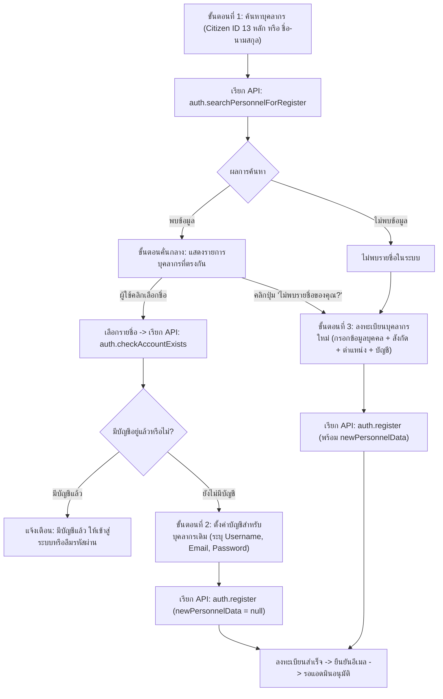

# 📘 REBUILD BLUEPRINT: Central Portal & SSO
## 04. พฤติกรรมการทำงานส่วนหน้าและสัญญาการเชื่อมต่อ (Frontend Functional Behavior Blueprint)

> **เป้าหมายเอกสาร:** ถอดรหัสพฤติกรรมการทำงานฝั่ง Frontend (Functional Behavior Only) ของ **Central Portal & SSO (`portal-apps-script`)** ครบทุกหน้าจอ ทุกฟิลด์ ทุกขั้นตอนการตรวจสอบข้อมูล และการเรียกใช้ API โดย**ไม่จำกัดรูปแบบ UI/UX/CSS** เพื่อให้โมเดล AI ตัวใหม่สามารถออกแบบหน้าตา UX/UI ใหม่ได้อย่างอิสระ แต่ยังคงพฤติกรรมการทำงานและการส่งข้อมูลตรงกับระบบเดิม 100%

---

## 1. Client Boot & State Architecture (สถาปัตยกรรมการเริ่มต้นระบบและสถานะไคลเอนต์)

ระบบ Central Portal & SSO ฝั่ง Frontend ทำงานเป็น Single Page Application (SPA) บนสถาปัตยกรรม Google Apps Script (GAS) โดยไม่มีการ Refresh หน้าจอเมื่อเปลี่ยนวิว

### 1.1 Server-Injected Configuration (`window.APP_BOOT`)
ใน `Index.html` เซิร์ฟเวอร์จะฉีด Object การตั้งค่าเริ่มต้นผ่าน GAS Scriptlet ก่อนส่ง HTML ไปยังเบราว์เซอร์:
```javascript
window.APP_BOOT = {
  mode: typeof initialMode !== 'undefined' ? initialMode : '',
  token: typeof initialToken !== 'undefined' ? initialToken : '',
  settings: typeof initialSettings !== 'undefined' ? initialSettings : {},
  errorMsg: typeof errorMsg !== 'undefined' ? errorMsg : ''
};
```
- **`mode`**: โหมดพิเศษที่ส่งมาจาก URL query parameter เช่น `'verify-success'` (ยืนยันอีเมลสำเร็จ), `'verify-error'` (ยืนยันอีเมลล้มเหลว), หรือ `'resetPassword'` / `'reset'` (เปิดหน้ารีเซ็ตรหัสผ่าน)
- **`token`**: โทเคนเริ่มต้นที่ส่งผ่านพารามิเตอร์ (เช่น กรณี Reset Password Token หรือ Email Verification Token)
- **`settings`**: อ็อบเจกต์การตั้งค่าระบบที่ดึงมาจากตาราง `System_Settings` บน Google Sheets เช่น `App_Display_Name`, `Login_Logo_URL`, `Dashboard_Logo_URL`, `Default_Theme`, `Default_Profile_Picture_URL`, `Profile_Folder_ID`, `Signature_Folder_ID`, `scriptUrl`
- **`errorMsg`**: ข้อความแสดงความผิดพลาดระดับวิกฤตจากเซิร์ฟเวอร์

### 1.2 การจัดเก็บข้อมูลในเครื่องไคลเอนต์ (`localStorage` Keys)
ระบบใช้ Web Storage API (`localStorage`) สำหรับคงสถานะการทำงานข้ามเซสชัน:
- **`cp_token`**: สตริง Auth Token ของผู้ใช้ที่เข้าสู่ระบบสำเร็จ (ใช้แนบกับทุก API Call)
- **`cp_read_notifs`**: Array ของ ID การแจ้งเตือนที่ผู้ใช้กดอ่านแล้ว (Serialized JSON Array เช่น `["pending_users_2"]`) เพื่อคำนวณจำนวน Unread Badge
- **`cp_theme`**: ธีมปัจจุบันของระบบ มีค่าเป็น `'light'` หรือ `'dark'` (หากไม่มีจะใช้ค่าจาก `APP_BOOT.settings.Default_Theme` หรือค่าเริ่มต้นเป็น `'light'`)
- **`BMA_Portal_Username`**: ชื่อผู้ใช้งานที่ถูกบันทึกไว้เมื่อเลือกติ๊กถูก "จดจำฉันไว้" (Remember Me) บนหน้า Login

### 1.3 ตัวกลางเรียก API ฝั่งไคลเอนต์ (`ApiClient`)
ฟังก์ชันการติดต่อ Backend ทั้งหมดถูกรวมศูนย์ไว้ที่ `ApiClient.call(action, payload)`:
- **กลไกการห่อหุ้ม:** ครอบ `google.script.run` ด้วย Native JavaScript `Promise`
- **การแนบ Authentication Token อัตโนมัติ:** ทุกคำขอจะแนบโทเคนปัจจุบันจาก `AppState.getToken()` ส่งไปในโครงสร้างคำขอ:
  ```javascript
  const req = {
    action: action,
    payload: payload || {},
    token: AppState.getToken()
  };
  ```
- **การส่งข้อมูล:** ส่งผ่านฟังก์ชันหลักของเซิร์ฟเวอร์ `google.script.run.withSuccessHandler(...).withFailureHandler(...).processClientRequest(JSON.stringify(req))`
- **การตอบกลับและการจัดการ Error:** ตรวจสอบแฟล็ก `res.success` หากเป็น `true` จะ Resolve ด้วย `res.data` หากเป็น `false` จะ Reject ด้วย `new Error(res.error || 'API Error')`

### 1.4 โครงสร้างสถานะส่วนกลาง (`AppState`)
`AppState` ทำหน้าที่เก็บ In-Memory State ของไคลเอนต์:
- **`user`**: อ็อบเจกต์ข้อมูลผู้ใช้งานที่ล็อกอินอยู่ในปัจจุบัน (ประกอบด้วย `Personnel_Ref_ID`, `Username`, `Email`, `Role`, `Prefix`, `First_Name`, `Last_Name`, `Position`, `Position_Level`, `Position_2`, `Bureau_Name`, `Office`, `Department`, `Division`, `Photo_URL`, `Signature_URL`, `Status_Personnel`, `ID_Card_Number`, `Start_Service_Year_BE`, `Current_Salary`)
- **`settings`**: ค่าคอนฟิกระบบที่แคชไว้
- **`references`**: รายการข้อมูลอ้างอิงระบบ

### 1.5 การควบคุมการแจ้งเตือน (`NotificationController`)
ดูแลกระดิ่งแจ้งเตือนบน Topbar:
- เรียก API `notifications.get`
- เทียบ ID รายการแจ้งเตือนกับ `AppState.getReadNotifications()` เพื่อคำนวณจำนวนที่ยังไม่ได้อ่าน (`unreadCount`)
- เมื่อผู้ใช้คลิกรายการแจ้งเตือน: เรียก `AppState.markNotificationRead(n.id)` และนำทางไปยัง `n.link` (เช่น `#users`)

---

## 2. Hash Router & Navigation Permissions (`AppRouter`)

### 2.1 ตารางเส้นทาง (Route Table) และสิทธิ์การเข้าถึง

| เส้นทาง (Hash Route) | ฟังก์ชันเริ่มต้น (`init_*`) | สิทธิ์บทบาทที่อนุญาต (Role Access) | วัตถุประสงค์การใช้งาน |
| :--- | :--- | :--- | :--- |
| `''` หรือ `#login` | `renderLogin()` | ทุกคน (Public / Unauthenticated) | หน้าลงชื่อเข้าใช้ และ Wizard สมัครสมาชิก |
| `#dashboard` | `AppController.init_dashboard()` | `USER`, `ADMIN`, `SUPERADMIN` | หน้ากระดานรวมแอปพลิเคชัน และ SSO Launcher |
| `#personnel` | `AppController.init_personnel()` | `ADMIN`, `SUPERADMIN` | ทำเนียบบุคลากร โครงสร้างสังกัด และประวัติ |
| `#users` | `AppController.init_users()` | `ADMIN`, `SUPERADMIN` | จัดการบัญชีผู้ใช้ สถานะอนุมัติ และสิทธิ์รายแอป |
| `#position` | `AppController.init_position()` | `ADMIN`, `SUPERADMIN` | กำหนดโครงสร้างประเภทตำแหน่ง ชื่อ และระดับ |
| `#reference` | `AppController.init_reference()` | `ADMIN`, `SUPERADMIN` | จัดการข้อมูลอ้างอิงระบบ (สำนัก/กอง/ฝ่าย/คำนำหน้า) |
| `#webapps` | `AppController.init_webapps()` | `SUPERADMIN` เท่านั้น | ทะเบียนแอปพลิเคชัน ไอคอน ลิงก์ และสถานะ |
| `#settings` | `AppController.init_settings()` | `SUPERADMIN` เท่านั้น | ตั้งค่าระบบ โฟลเดอร์ Drive ตรวจลิงก์ และ Cron |

### 2.2 การป้องกัน Iframe Breakout บน Google Apps Script
ในหน้า Layout ของ Apps Script หากมีการกำหนด `<base target="_top">` จะทำให้ลิงก์ `<a href="#...">` สั่งเปลี่ยน URL หน้าต่างนอกสุดและหลุดออกจาก Sandbox ไปยังโดเมน `googleusercontent.com` ดังนั้นทุกลิงก์เปลี่ยนหน้าภายใน SPA ต้องใช้ `e.preventDefault(); window.location.hash = targetHash;` เสมอ

---

## 3. Authentication & Registration Workflows (กระบวนการยืนยันตัวตนและลงทะเบียน)

### 3.1 ระบบเข้าสู่ระบบ (Login Workflow)
- **ฟิลด์:** `username` (ชื่อผู้ใช้หรืออีเมล), `password`, `rememberMe`
- **การทำงาน:** เรียก API `auth.login` พร้อม `{ username, password }` เมื่อสำเร็จจะเก็บ `res.token` ลง `localStorage` (`cp_token`) แล้วเปลี่ยนเส้นทางไป `#dashboard`

### 3.2 ระบบลงทะเบียน 3 ขั้นตอน (3-Step Registration Wizard)



1. **ขั้นตอนที่ 1 (ค้นหาบุคลากรเดิม):**
   - ค้นหาด้วยเลขประจำตัวประชาชน 13 หลัก (`idCard`) หรือ คำนำหน้า/ชื่อจริง/นามสกุล (`firstName`, `lastName`) ผ่าน `auth.searchPersonnelForRegister`
   - เมื่อคลิกเลือกรายชื่อ จะเรียก `auth.checkAccountExists({ personnelId })` เพื่อตรวจว่ามีบัญชีผูกอยู่แล้วหรือไม่
2. **ขั้นตอนที่ 2 (กรณีพบประวัติบุคลากรเดิมและยังไม่มีบัญชี):**
   - แสดงชื่อบุคลากรที่อ้างอิง และให้กรอกเฉพาะ `username`, `email`, `password` (ขั้นต่ำ 6 ตัวอักษร), `confirmPassword`
   - ส่ง `auth.register` พร้อม `{ personnelId, username, email, password, newPersonnelData: null }`
3. **ขั้นตอนที่ 3 (กรณีเป็นบุคลากรใหม่ที่ยังไม่มีประวัติในระบบ):**
   - โหลดข้อมูลตัวเลือกผ่าน `auth.getRegistrationDropdowns` (`{ references, positions }`)
   - **Cascading สังกัด:** `Office` (`Type === 'Office'`) -> `Department` (`Type === 'Department' && Parent_Value === selectedOffice`) -> `Division` (`Type === 'Division' && Parent_Value === selectedDepartment`)
   - **Cascading ตำแหน่ง:** `Position_Type` -> `Position` (`Position_Name`) -> `Position_Level`
   - กรอกข้อมูลบุคลากร (`idCard`, `prefix`, `firstName`, `lastName`, `positionType`, `position`, `positionLevel`, `office`, `department`, `division`) และข้อมูลบัญชี (`username`, `email`, `password`) แล้วส่ง `auth.register`

---

## 4. Dashboard & SSO App Launcher (กระดานควบคุมและการส่งต่อ SSO)

### 4.1 การโหลดรายการแอปพลิเคชัน (`init_dashboard`)
- เรียก API `dashboard.apps` เพื่อดึงเฉพาะเว็บแอปพลิเคชันที่ผู้ใช้มีสิทธิ์เข้าถึง
- กรองแสดงเฉพาะแอปที่มีสถานะ `Status === 'Active' || Status === 'เปิดใช้งาน' || Status === 'true'`

### 4.2 กลไกการยิง SSO Token ข้ามระบบ (`launchApp(webappId, appUrl)`)
1. **ป้องกัน Popup Blocker:** ทันทีที่ผู้ใช้คลิกการ์ดแอป ต้องสั่ง `const newWindow = window.open('', '_blank');` ทันทีใน Synchronous Event Handler แล้วแสดงหน้า Loading ชั่วคราวในแท็บใหม่นั้น
2. เรียก API `auth.generateSSOToken({ webappId })` เพื่อรับ `{ ssoToken }` (อายุ 5 นาที ใช้ได้ครั้งเดียว)
3. ตรวจสอบ `appUrl` ว่ามี `?` อยู่แล้วหรือไม่ แล้วเปลี่ยน URL ของแท็บใหม่ไปยัง `appUrl + (appUrl.includes('?') ? '&' : '?') + 'sso_token=' + ssoToken`
4. หากเกิดข้อผิดพลาด ให้สั่ง `newWindow.close()` และแจ้งเตือนผู้ใช้บนหน้า Portal

---

## 5. Self-Service My Profile Modal (หน้าต่างจัดการโปรไฟล์ตนเอง)

- **การแสดงผล (`openMyProfile`):** แสดงรูปถ่ายโปรไฟล์, ชื่อ-นามสกุล, ตำแหน่งสายงานและระดับ, ตำแหน่งบริหาร (`Position_2`), สถานะการปฏิบัติงาน, เลขบัตรประชาชน (ฟอร์แมต `X-XXXX-XXXXX-XX-X`), สังกัด (`Bureau_Name`, `Office`, `Department`, `Division`), และอีเมล
- **การแก้ไข (`editMyProfile` & `saveMyProfile`):**
  - อนุญาตให้ผู้ใช้ทั่วไปแก้ไข: `Email`, `Password` (ถ้ากรอกใหม่), รูปถ่ายโปรไฟล์ (`Photo_Base64` ขนาดไม่เกิน 2MB), และรูปลายเซ็น (`Signature_Base64` ขนาดไม่เกิน 2MB)
  - บันทึก 2 จังหวะ: เรียก `auth.updateMyProfile` ตามด้วย `personnel.save` แล้วบังคับ Logout เพื่อให้เข้าสู่ระบบใหม่

---

## 6. Admin Module Specifications (ข้อกำหนดการทำงานโมดูลผู้ดูแลระบบ)

### 6.1 Users & App Permissions (`UsersUI`)
- โหลดข้อมูลด้วย `Promise.all([ApiClient.call('users.list'), ApiClient.call('webapps.list')])`
- **ปุ่มด่วนสำหรับบัญชี `'รออนุมัติ'`:** มีปุ่มกด "อนุมัติ" (`Status: 'ใช้งานปกติ'`) และ "ระงับ" (`Status: 'ระงับบัญชี'`) เรียก `users.save` ทันที
- **สร้างผู้ใช้ใหม่:** ค้นหาบุคลากรที่ยังไม่มีบัญชีผ่าน `personnel.searchUnregistered({ Query })` หรือสร้างประวัติบุคลากรใหม่พร้อมบัญชีผ่าน `users.create` (ซ่อนตัวเลือก `SUPERADMIN` หากผู้สร้างไม่ใช่ `SUPERADMIN`)
- **จัดการสิทธิ์รายแอป (`permissions.get` & `permissions.save`):** แสดงรายการ Webapps ทั้งหมดพร้อมสวิตช์เปิด/ปิด (`Access_Level`: `'USER'` / `'ADMIN'` หรือ `'None'`) สำหรับผู้ใช้ที่ไม่ใช่ `SUPERADMIN`
- **ลบบัญชี (`users.delete`):** เฉพาะ `SUPERADMIN` เท่านั้น และห้ามลบบัญชีตัวเอง

### 6.2 Personnel Directory (`PersonnelUI`)
- โหลดข้อมูลด้วย `Promise.all([ApiClient.call('personnel.list'), ApiClient.call('references.list'), ApiClient.call('positions.list')])`
- **การจัดกลุ่มตาราง 3 ชั้น (Hierarchical Grouping):** จัดกลุ่มตาม `Office` (สำนักงาน/กอง) -> `Department` (ฝ่าย/ส่วน) -> `Division` (กลุ่มงาน)
  - ลำดับการเรียง `Department` พิเศษ: `['ฝ่ายบริหารงานทั่วไป', 'ส่วนตรวจและบังคับการ 1', 'ส่วนตรวจและบังคับการ 2', 'ส่วนตรวจและบังคับการ 3']` ตามด้วยตัวอักษร
  - ลำดับการเรียง `Division` พิเศษ: `['กลุ่มงานกิจการพิเศษ', 'กลุ่มงานปฏิบัติการ']` ตามด้วยตัวอักษร
- **ฟอร์มเพิ่ม/แก้ไขบุคลากร (`personnel.save`):**
  - Cascading ตำแหน่ง: `Position_Type` -> `Position` -> `Position_Level`
  - ตำแหน่งรอง/รักษาการ (`Position_2`): มีตัวเลือกคำนำหน้า (`'ปฏิบัติราชการแทน'`, `'รักษาการในตำแหน่ง'`) ต่อด้วยชื่อตำแหน่งบริหาร
  - Cascading สังกัด: `Bureau_Name` -> `Office` -> `Department` -> `Division`
  - อัปโหลดรูปโปรไฟล์ (`Photo_Base64`) และลายเซ็น (`Signature_Base64`) ขนาดไม่เกิน 2MB (ตรวจสอบก่อนว่าตั้งค่า `Profile_Folder_ID` และ `Signature_Folder_ID` แล้ว)

### 6.3 Webapps Management (`WebappsUI` - เฉพาะ `SUPERADMIN`)
- จัดการทะเบียนเว็บแอปพลิเคชัน (`webapps.list`, `webapps.save`, `webapps.delete`)
- ฟิลด์: `Webapp_ID`, `Name`, `Status` (`เปิดใช้งาน`, `ปิดชั่วคราว`, `ยกเลิก`), `Description`, `URL` (`https://script.google.com/.../exec`), `Icon_URL`

### 6.4 Position Structure (`PositionUI`)
- จัดการโครงสร้างตำแหน่ง (`positions.list`, `positions.save`, `positions.delete`) จัดกลุ่มตาม `Position_Type`
- ฟิลด์: `Pos_ID`, `Position_Type`, `Position_Name`, `Position_Level`, `Sort_Order`, `Is_Active` (`'TRUE'` / `'FALSE'`)

### 6.5 Reference Data (`ReferenceUI`)
- จัดการข้อมูลอ้างอิง (`references.list`, `references.save`, `references.delete`) จัดกลุ่มตาม `Type` (`Bureau_Name`, `Office`, `Department`, `Division`, `Prefix`)
- ฟิลด์: `Reference_ID`, `Type`, `Value`, `Short_Name`, `Parent_Type`, `Parent_Value`, `Sort_Order`, `Is_Active`

### 6.6 System Settings (`SettingsUI` - เฉพาะ `SUPERADMIN`)
- โหลดข้อมูลผ่าน `settings.get` แสดงสถานะ Cron Job (`cronJobActive`) และปุ่มเปิดใช้งาน `settings.setupCron`
- **Mandatory Link Checker Pattern:** สำหรับคีย์ที่เป็นลิงก์หรือโฟลเดอร์ Google Drive (`Profile_Folder_ID`, `Signature_Folder_ID`, `Login_Logo_URL`, `Dashboard_Logo_URL`, `Default_Profile_Picture_URL`) เมื่อผู้ใช้แก้ไขค่าในช่อง ปุ่มบันทึกหลักจะถูกล็อก (Disabled) จนกว่าผู้ใช้จะกดปุ่ม **"ตรวจสอบ Link"** (`settings.testDriveLink`) ให้ผ่าน (`res.ok === true`) ครบทุกช่องที่แก้ไข

---

## 7. Complete Frontend-to-Backend API Mapping Table (ตารางเชื่อมโยง API ทั้งระบบ)

| หน้าจอ / ปุ่มกดที่เรียกใช้ | Action String ใน `ApiClient.call` | โครงสร้าง Payload ที่ส่งไป | ผลลัพธ์ที่ตอบกลับมา (Expected Response) |
| :--- | :--- | :--- | :--- |
| **Boot / ตรวจสอบโทเคน** | `auth.verifySession` | `{}` | ข้อมูล User Object ของผู้ใช้ปัจจุบัน |
| **Navbar / กระดิ่งแจ้งเตือน** | `notifications.get` | `{}` | Array ของรายการแจ้งเตือน `[{ id, title, message, link }]` |
| **Login / ปุ่มเข้าสู่ระบบ** | `auth.login` | `{ username, password }` | `{ message, token, role, userId, mustChangeUsername }` |
| **Topbar / ปุ่มออกจากระบบ** | `auth.logout` | `{}` | `{ success: true }` |
| **Register Step 1 / ตรวจสอบข้อมูล** | `auth.searchPersonnelForRegister` | `{ idCard, firstName, lastName }` | Array ของรายชื่อบุคลากรที่ค้นพบ `[{ personnelId, prefix, firstName, lastName, position, department }]` |
| **Register Step 1 / ตรวจสอบบัญชีซ้ำ** | `auth.checkAccountExists` | `{ personnelId }` | `{ exists: boolean }` |
| **Register Step 3 / โหลด Dropdown** | `auth.getRegistrationDropdowns` | `{}` | `{ references: [...], positions: [...] }` |
| **Register Step 2-3 / ปุ่มยืนยันสมัคร** | `auth.register` | `{ personnelId, username, email, password, newPersonnelData }` | `{ message }` |
| **Auth / ส่งลิงก์ลืมรหัสผ่าน** | `auth.requestReset` | `{ email }` | `{ message }` |
| **Topbar / บันทึกโปรไฟล์ (Auth)** | `auth.updateMyProfile` | `{ Email, Password, Photo_Base64, Signature_Base64 }` | `{ message }` |
| **Topbar / บันทึกโปรไฟล์ (ข้อมูลบุคคล)** | `personnel.save` | ข้อมูลประวัติและสังกัดทั้งหมด | `{ id, message }` |
| **Dashboard / โหลดการ์ดแอป** | `dashboard.apps` | `{}` | Array ของ Webapps ที่ผู้ใช้มีสิทธิ์เข้าใช้งาน |
| **Dashboard / คลิกการ์ดเปิดแอป** | `auth.generateSSOToken` | `{ webappId }` | `{ ssoToken }` |
| **Users / โหลดตารางผู้ใช้** | `users.list` | `{}` | Array ของบัญชีผู้ใช้ทั้งหมดในระบบ |
| **Users / ค้นหาบุคลากรไม่มีบัญชี** | `personnel.searchUnregistered` | `{ Query }` | Array ของบุคลากรที่ยังไม่มีบัญชีผู้ใช้ |
| **Users / สร้างผู้ใช้งานใหม่** | `users.create` | `{ Personnel_Ref_ID, Prefix, First_Name, Last_Name, Username, Email, Password, Role, Status }` | `{ id, message }` |
| **Users / บันทึกแก้ไข/อนุมัติ/ระงับ** | `users.save` | `{ Personnel_Ref_ID, Role, Status, newPassword }` | `{ message }` |
| **Users / ลบบัญชีผู้ใช้** | `users.delete` | `{ Personnel_Ref_ID }` | `{ message }` |
| **Users / โหลดสิทธิ์แอปรายบุคคล** | `permissions.get` | `{ Personnel_Ref_ID }` | Array ของสิทธิ์ `[{ Webapp_ID, Access_Level }]` |
| **Users / บันทึกสิทธิ์แอปรายบุคคล** | `permissions.save` | `{ Personnel_Ref_ID, Permissions: [{ Webapp_ID, Access_Level }] }` | `{ message }` |
| **Personnel / โหลดทำเนียบบุคลากร** | `personnel.list` | `{}` | Array ของข้อมูลบุคลากรทั้งหมด |
| **Personnel / บันทึกข้อมูลบุคลากร** | `personnel.save` | `{ Personnel_ID, Prefix, First_Name, Last_Name, ID_Card_Number, Start_Service_Year_BE, Current_Salary, Status, Position_Type, Position, Position_Level, Position_2, Bureau_Name, Office, Department, Division, Photo_URL, Photo_Base64, Signature_URL, Signature_Base64 }` | `{ id, message }` |
| **Personnel / ลบข้อมูลบุคลากร** | `personnel.delete` | `{ Personnel_ID }` | `{ message }` |
| **Webapps / โหลดทะเบียนแอป** | `webapps.list` | `{}` | Array ของแอปพลิเคชันทั้งหมด |
| **Webapps / บันทึกข้อมูลแอป** | `webapps.save` | `{ Webapp_ID, Name, Description, URL, Icon_URL, Status }` | `{ message }` |
| **Webapps / ลบแอปพลิเคชัน** | `webapps.delete` | `{ Webapp_ID }` | `{ message }` |
| **Position / โหลดโครงสร้างตำแหน่ง** | `positions.list` | `{}` | Array ของรายการตำแหน่งและระดับทั้งหมด |
| **Position / บันทึกตำแหน่ง** | `positions.save` | `{ Pos_ID, Position_Type, Position_Name, Position_Level, Sort_Order, Is_Active }` | `{ message }` |
| **Position / ลบตำแหน่ง** | `positions.delete` | `{ Pos_ID }` | `{ message }` |
| **Reference / โหลดข้อมูลอ้างอิง** | `references.list` | `{}` | Array ของข้อมูลอ้างอิงทั้งหมด |
| **Reference / บันทึกข้อมูลอ้างอิง** | `references.save` | `{ Reference_ID, Type, Value, Short_Name, Parent_Type, Parent_Value, Sort_Order, Is_Active }` | `{ message }` |
| **Reference / ลบข้อมูลอ้างอิง** | `references.delete` | `{ Reference_ID }` | `{ message }` |
| **Settings / โหลดการตั้งค่าและ Cron** | `settings.get` | `{}` | `{ settings: [...], cronJobActive: boolean }` |
| **Settings / ตรวจสอบลิงก์/โฟลเดอร์** | `settings.testDriveLink` | `{ url, key }` | `{ ok: boolean, message }` |
| **Settings / บันทึกการตั้งค่า** | `settings.update` | `{ settings: [{ Key, Value }] }` | `{ message }` |
| **Settings / ติดตั้ง Cron Trigger** | `settings.setupCron` | `{}` | `{ message }` |

