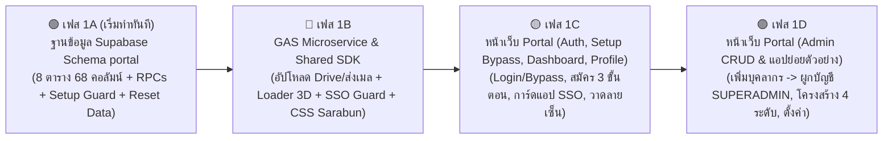

# 📑 แผนปฏิบัติการระบบ Central Portal & SSO (แบ่ง 4 เฟสย่อยเพื่อประหยัด Token)
**(ฐานข้อมูล Supabase Schema `portal` 100% + First-Time Setup Bypass + Reset Test Data + GAS Microservice + ธีมสี กทม. & `Loader.html` 3D Flip + ฟอนต์หลัก `Sarabun`)**

> [!IMPORTANT]
> **1. การแบ่งเฟสทำงาน (4 เฟสย่อย - Token-Safe Execution):**
> แบ่งการสร้างระบบออกเป็น **4 เฟสย่อย (Phase 1A $\rightarrow$ 1B $\rightarrow$ 1C $\rightarrow$ 1D)** เพื่อป้องกันปัญหา Token เต็มระหว่างรัน และทดสอบความถูกต้องได้ทีละส่วน
>
> **2. ระบบตั้งค่าครั้งแรกอัตโนมัติ (`First-Time Setup Bypass Mode`):**
> - **ไม่สร้างข้อมูลบุคลากรหรือบัญชี `superadmin` จำลองทิ้งไว้ในฐานข้อมูล**
> - เมื่อเปิดเข้าเว็บแอป ระบบจะเรียก RPC `portal.fn_check_system_init()` ตรวจสอบว่าในตาราง `portal.users` มีผู้ใช้งานที่มีสิทธิ์ `Role = 'SUPERADMIN'` หรือไม่:
>   - **กรณีที่ยังไม่มี `SUPERADMIN` (`has_superadmin = false`):** ระบบจะ **Bypass หน้า Login เข้าสู่ระบบให้อัตโนมัติ** ในสถานะ **"โหมดตั้งค่าระบบครั้งแรก (First-Time Setup)"** พร้อมแถบแนะนำขั้นตอนด้านบน ให้คุณสามารถ:
>     1. ตั้งค่าโครงสร้างหน่วยงาน/ตำแหน่ง (ถ้าต้องการ) และไปที่เมนู **`#personnel` (ทำเนียบบุคลากร)** เพื่อเพิ่มข้อมูลบุคลากรจริงของคุณเองก่อน
>     2. ไปที่เมนู **`#users` (จัดการผู้ใช้งาน)** เพื่อสร้างบัญชีผู้ใช้งาน เลือกผูกกับชื่อบุคลากรที่เพิ่งสร้าง และกำหนดสิทธิ์เป็น **`SUPERADMIN`** (สถานะ `'ใช้งานปกติ'`)
>     3. **ล็อกระบบอัตโนมัติ:** ทันทีที่บันทึกบัญชี `SUPERADMIN` คนแรกสำเร็จ ฐานข้อมูล Supabase จะปิดโหมด Bypass ถาวรทันที และออก Session Token ของบัญชี `SUPERADMIN` ให้คุณใช้งานต่อเนื่องได้เลย!
>   - **กรณีที่มี `SUPERADMIN` แล้ว (`has_superadmin = true`):** ระบบจะบังคับผ่านหน้า Login และตรวจ Session Token ตามปกติ 100%
>
> **3. ฟังก์ชันล้างข้อมูลทดสอบ (`portal.fn_reset_test_data`):**
> - เพิ่มฟังก์ชัน RPC `portal.fn_reset_test_data(p_session_token, p_mode)` และปุ่มในหน้า `#settings` (เฉพาะ `SUPERADMIN`) ให้เลือกล้างข้อมูลทดสอบได้ 2 โหมด:
>   - **โหมดที่ 1 (`USERS_AND_PERSONNEL`):** ล้างตาราง `security_tokens`, `permissions`, `users`, และ `personnel` เพื่อกลับไปเริ่มทดสอบโหมด **First-Time Setup Bypass** ใหม่ตั้งแต่ต้น (โดยที่ค่าตั้งค่าระบบและโครงสร้างสำนัก/กอง/ตำแหน่งยังอยู่ครบ)
>   - **โหมดที่ 2 (`FULL_FACTORY_RESET`):** ล้างข้อมูลทุกตารางและรีเซ็ตค่าเริ่มต้น (`system_settings`, `reference_data`, `position_structure`) กลับเป็นค่าโรงงานใหม่เอี่ยม 100%
>
> **4. มาตรฐานฟอนต์หลัก (`Sarabun` จาก Google Fonts):**
> ดึงฟอนต์ **`Sarabun`** จาก Google Fonts (`https://fonts.googleapis.com/css2?family=Sarabun:wght@300;400;500;600;700;800&display=swap`) และตั้งค่า `font-family: 'Sarabun', sans-serif;` เป็นฟอนต์หลักทั้งระบบ

---

## 🗓️ ภาพรวมการแบ่ง 4 เฟสย่อย (Phased Roadmap)

| เฟสย่อย | ขอบเขตงานที่จะทำในแต่ละรอบ | ไฟล์ที่สร้าง/แก้ไข | สถานะ |
| :--- | :--- | :--- | :---: |
| **🟢 เฟส 1A** *(รอบนี้)* | **Supabase Database Schema `portal` & RPCs 100%** - สร้าง Schema `portal` และตารางทั้ง 8 ตาราง (ครบ 68 คอลัมน์) - สร้างฟังก์ชัน RPC ทั้งหมด รวมทั้ง **`fn_check_system_init()`**, กลไก First-Time Setup Bypass Guard และ **`fn_reset_test_data()`** สำหรับล้างข้อมูลทดสอบ - Seed เฉพาะค่าตั้งต้นระบบ: 13 `System_Settings`, โครงสร้างสังกัด กทม. 4 ระดับ และตำแหน่ง กทม. 6 ประเภท *(ปล่อยตาราง `personnel` และ `users` ให้ว่างไว้สำหรับทำ First-Time Setup จริง)* - รัน Migration เข้า Supabase จริงและทดสอบ RPC ทันที | - `supabase/migrations/01_portal_schema_and_tables.sql` - `supabase/migrations/02_portal_rpc_and_seed.sql` | **🎯 เป้าหมายเมื่อกด Proceed รอบนี้** |
| **🔵 เฟส 1B** | **GAS Microservice + Shared SDK & 3D Loader + ธีมสี/ฟอนต์ `Sarabun`** - อัปเดตโค้ด GAS (`doPost` อัปโหลดไฟล์เข้า Google Drive Folder + ส่งอีเมลยืนยัน/รีเซ็ตรหัสผ่าน) และสั่ง `clasp push` - สร้าง `shared/stb-loader.js` (BMA 3D Logo Flip Loader 4 โหมด) - สร้าง `shared/stb-sso-guard.js` & `shared/stb-drive-upload.js` - สร้าง `assets/css/portal.css` (ธีมสีเขียว กทม. Light/Dark Mode + ฟอนต์หลัก **`Sarabun`** จาก Google Fonts) | - `gas/appsscript.json` - `gas/รหัส.js` - `shared/stb-loader.js` - `shared/stb-sso-guard.js` - `shared/stb-drive-upload.js` - `assets/css/portal.css` | รอทำต่อจากเฟส 1A |
| **🟡 เฟส 1C** | **Central Portal SPA (ส่วนที่ 1: โครงสร้างหลัก, First-Time Setup Bypass, Auth, Dashboard & Profile)** - สร้าง `index.html`, `portal-config.js`, `portal-api.js` - ระบบตรวจสอบ `has_superadmin` ตอนเปิดเว็บ: ถ้ายังไม่มีให้ Bypass เข้าโหมดตั้งค่าเริ่มต้นพร้อมแถบแนะนำขั้นตอนด้านบน / ถ้ามีแล้วให้แสดงหน้า Login ปกติ - หน้า `#dashboard` (แสดงการ์ดเว็บแอปย่อยตามสิทธิ์ + ยิง SSO Token) - หน้า `#profile` (แก้ไขข้อมูลตนเอง, เปลี่ยน Username 1 ครั้ง, อัปโหลดรูป & กระดานวาดลายเซ็น) | - `index.html` - `assets/js/portal-config.js` - `assets/js/portal-api.js` - `assets/js/portal-app.js` (ส่วนที่ 1) | รอทำต่อจากเฟส 1B |
| **🟣 เฟส 1D** | **Central Portal SPA (ส่วนที่ 2: ระบบจัดการ Admin/Superadmin & แอปย่อยตัวอย่าง)** - หน้า `#personnel` & หน้า `#users` (สร้างบัญชีผู้ใช้ผูกกับบุคลากร, ตั้งเป็น `SUPERADMIN` คนแรกพร้อม Auto-Login ทันที) - หน้า `#webapps`, `#reference` & `#positions` (พร้อมปุ่มเลื่อน `▲▼` และ Batch Add), `#settings` (13 Keys + ปุ่ม `ตรวจสอบ` พรีวิวโลโก้สด + ปุ่ม `รีเซ็ตข้อมูลทดสอบ`) - สร้าง `apps/sample-subapp/index.html` ทดสอบ SSO ครบวงจร และ Push ขึ้น GitHub Pages | - `assets/js/portal-app.js` (ส่วนที่ 2) - `apps/sample-subapp/index.html` | รอทำต่อจากเฟส 1C |
